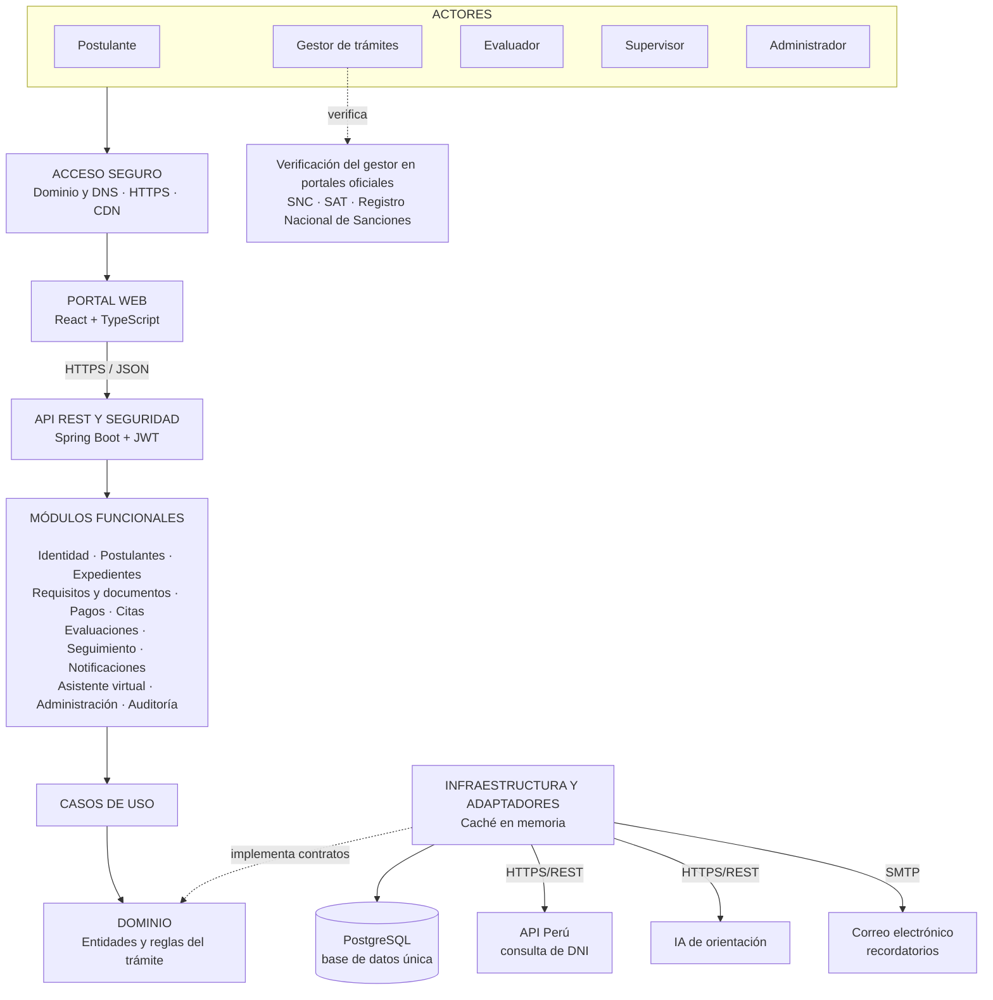

# Arquitectura inicial del sistema

El sistema utilizará una **arquitectura monolítica modular** organizada internamente con Clean Architecture. Esta estructura separa la interfaz, los módulos funcionales, las reglas del trámite y la infraestructura.

## Diagrama de arquitectura

## Componentes principales

- **Acceso seguro:** dominio, DNS, certificado SSL/TLS y CDN.
- **Portal web:** presenta los paneles según el rol del usuario.
- **API REST:** recibe las solicitudes y controla la autenticación y los permisos.
- **Módulos funcionales:** gestionan expedientes, requisitos, pagos, citas, evaluaciones, seguimiento y notificaciones.
- **Dominio:** contiene las reglas del trámite (3 intentos, vigencia del certificado, orden de los exámenes y bloqueo de resultados).
- **Infraestructura:** administra la base de datos, la caché y los adaptadores de los servicios externos.
