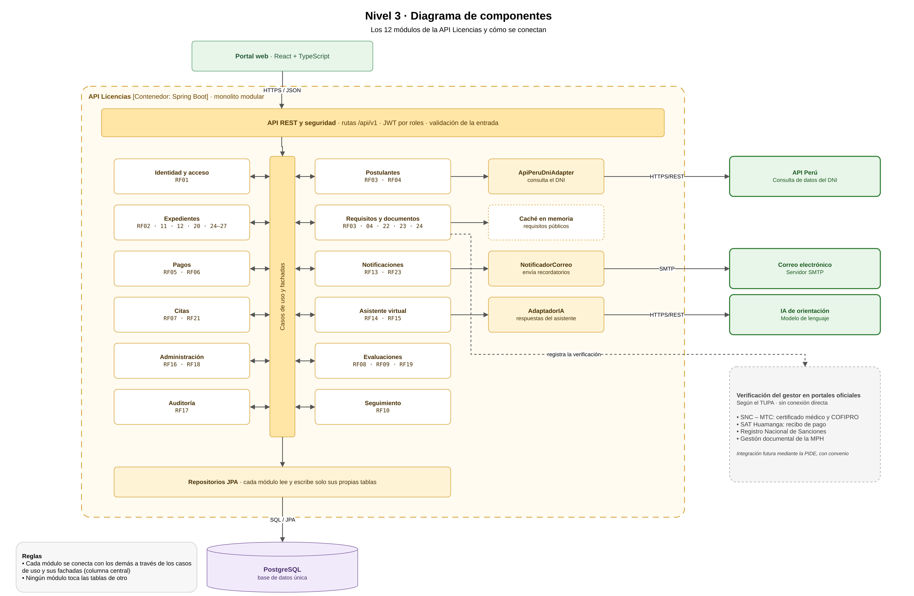

# Componentes arquitectónicos

El diagrama muestra los componentes internos de la API del Sistema de Licencias Clase B. Cada componente es un módulo del monolito modular: todos se despliegan juntos en una sola aplicación Spring Boot, pero cada uno tiene una responsabilidad definida y se organiza internamente con Clean Architecture.

> Archivo editable: `img/fuentes/nivel3-componentes.drawio`. Este diagrama corresponde también al nivel 3 del modelo C4.

## Componentes y su origen

| Componente | Responsabilidad | Requisitos | Drivers |
|---|---|---|---|
| **API REST y seguridad** | Expone `/api/v1`, valida la entrada y autentica mediante JWT | RF01 | DA01 |
| **Casos de uso y fachadas** | Coordinan los módulos; cada módulo usa a otro solo mediante su fachada | — | DA05 |
| **Identidad y acceso** | Usuarios, roles y permisos | RF01 | DA01 |
| **Postulantes** | Datos personales y validación del DNI con API Perú | RF03, RF04 | DA02, DA06 |
| **Expedientes** | Solicitud (emisión, revalidación y duplicado), etapas, validación del expediente y emisión | RF02, RF11, RF12, RF20, RF24–RF27 | DA04, DA05 |
| **Requisitos y documentos** | Requisitos según el TUPA, documentos, vigencia del certificado y verificación del gestor | RF03, RF04, RF22, RF23, RF24 | DA02, DA06 |
| **Pagos** | Registro del recibo del SAT y su verificación | RF05, RF06 | DA06 |
| **Citas** | Días de examen, cupos y elección de la cita por el postulante | RF07, RF21 | DA04 |
| **Evaluaciones** | Resultados de conocimientos y manejo, máximo 3 intentos y bloqueo después de validar | RF08, RF09, RF19 | DA04 |
| **Seguimiento** | Estado, historial, pendientes y plazo legal | RF10 | DA10 |
| **Notificaciones** | Avisos internos y recordatorios por correo | RF13, RF23 | DA10 |
| **Asistente virtual** | Orientación con contenido aprobado y derivación al gestor | RF14, RF15 | DA07 |
| **Administración** | Usuarios, catálogos, días de examen, cupos, contenidos y reportes | RF16, RF18 | DA05 |
| **Auditoría** | Registro de las operaciones importantes de todos los módulos | RF17 | DA03 |

## Datos y servicios externos

| Elemento | Tipo | Uso |
|---|---|---|
| **PostgreSQL** | Base de datos única | Cada módulo lee y escribe solo sus propias tablas, incluidos los documentos |
| **Caché en memoria** | Dentro del monolito | Requisitos y categorías públicas (ADR-009) |
| **API Perú** | Integración real (HTTPS/REST) | Consulta de datos del DNI |
| **IA de orientación** | Integración real (HTTPS/REST) | Respuestas del asistente virtual |
| **Correo electrónico** | Integración real (SMTP) | Recordatorios de examen y vencimientos |
| **SNC, SAT y Registro Nacional de Sanciones** | Verificación del gestor en portales oficiales | El sistema registra la verificación; integración futura mediante la PIDE |

## Reglas de comunicación

- Todos los componentes se despliegan juntos en el contenedor API Licencias (ADR-001).
- Un módulo usa a otro solo mediante su fachada, nunca accede a sus tablas.
- Las integraciones externas se implementan con adaptadores, según Clean Architecture (ADR-002, ADR-007).
- Todos los módulos registran sus operaciones importantes en Auditoría (ADR-006).
