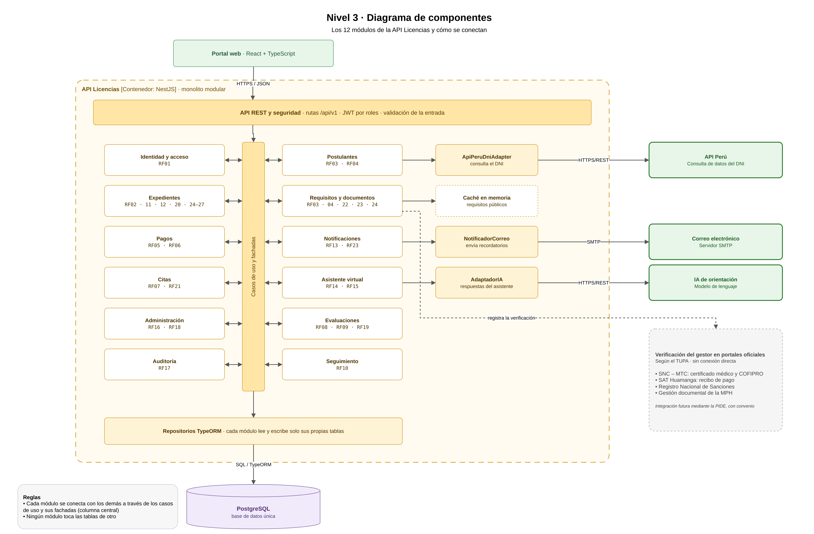

# Componentes arquitectónicos

Cada componente es un módulo del monolito. Todos se despliegan juntos en una sola aplicación NestJS.

> Archivo editable: `img/fuentes/nivel3-componentes.drawio`

| Componente | Responsabilidad | Requisitos |
|---|---|---|
| **Identidad y acceso** | Usuarios, roles y permisos | RF01 |
| **Postulantes** | Datos personales y DNI con API Perú | RF03, RF04 |
| **Expedientes** | Emisión, revalidación, duplicado, etapas y revisión del supervisor | RF02, RF11, RF12, RF20, RF24, RF25, RF26, RF27 |
| **Requisitos y documentos** | Requisitos del TUPA y vigencia del certificado | RF22, RF23 |
| **Pagos** | Recibo del SAT y su verificación | RF05, RF06 |
| **Citas** | Días de examen y cupos | RF07, RF21 |
| **Evaluaciones** | Resultados, máximo 3 intentos | RF08, RF09, RF19 |
| **Seguimiento** | Estado y plazo legal | RF10 |
| **Notificaciones** | Avisos y recordatorios por correo | RF13 |
| **Asistente virtual** | Orientación con la IA y contenido aprobado; pendientes y recordatorios de cada rol | RF14, RF15 |
| **Administración** | Configuración y reportes | RF16, RF18 |
| **Auditoría** | Registro de operaciones | RF17 |

## Componentes en el código

| Componente | Módulos de `tecnologia/backend/src/modulos` |
|---|---|
| Expedientes | `expedientes` (etapas y plazo) y `revision` (verificaciones en el SNC y sanciones, observaciones del supervisor, emisión y licencia). `revision` usa la fachada de `expedientes`; si estuviera dentro, la emisión y la fachada se necesitarían mutuamente |
| Requisitos y documentos | `requisitos` y `documentos` |
| Seguimiento | dentro de `expedientes` (plazo legal) |
| Administración | dentro de `identidad` (roles) y `asistente` (contenido aprobado); los reportes (RF18) quedan para el sprint 3 |

## Comunicación entre módulos

| Regla | Ejemplo |
|---|---|
| Un módulo usa a otro solo mediante su fachada | Evaluaciones pide `avanzarEtapa` a Expedientes |
| Un cambio de estado avisa sin acoplar módulos | Expedientes avisa a Notificaciones y Auditoría |
| Cada módulo lee y escribe solo sus tablas | Pagos no consulta las tablas de Citas |
