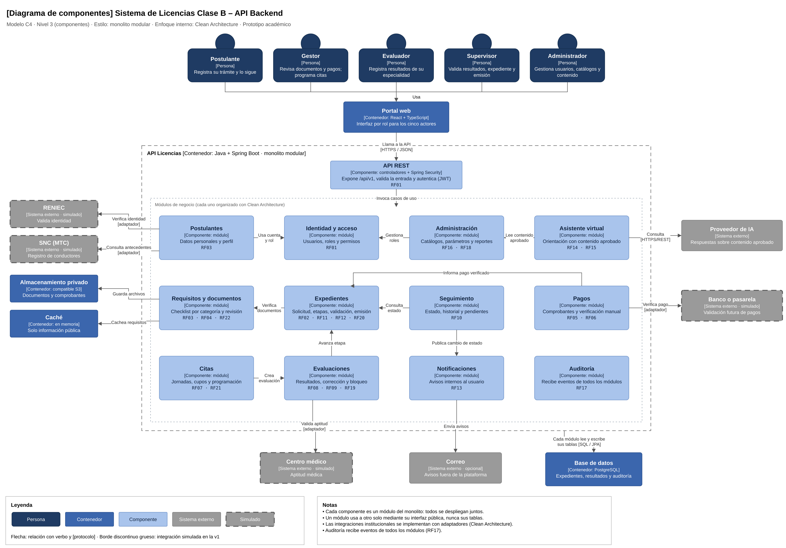

# Componentes arquitectónicos

El diagrama muestra los componentes internos de la API del Sistema de Licencias Clase B. Cada componente es un módulo del monolito modular: todos se despliegan juntos en una sola aplicación Spring Boot, pero cada uno tiene una responsabilidad definida y se organiza internamente con Clean Architecture.

> Archivo editable: `img/fuentes/nivel3-componentes.drawio`. Este diagrama corresponde también al nivel 3 del modelo C4.

## Componentes y su origen

| Componente | Responsabilidad | Requisitos | Drivers |
|---|---|---|---|
| **API REST** | Expone `/api/v1`, valida la entrada y autentica mediante JWT | RF01 | DA01 |
| **Identidad y acceso** | Usuarios, roles y permisos | RF01 | DA01 |
| **Postulantes** | Datos personales y perfil del postulante | RF03 | DA02 |
| **Expedientes** | Solicitud, etapas, validación del expediente y emisión simulada | RF02, RF11, RF12, RF20 | DA04, DA05 |
| **Requisitos y documentos** | Checklist por categoría, carga y revisión de documentos | RF03, RF04, RF22 | DA02, DA06 |
| **Pagos** | Registro de comprobantes y verificación manual | RF05, RF06 | DA06, DA08 |
| **Citas** | Jornadas, cupos, programación y reprogramación | RF07, RF21 | DA04 |
| **Evaluaciones** | Registro, corrección y bloqueo de resultados | RF08, RF09, RF19 | DA04 |
| **Seguimiento** | Estado, historial y acciones pendientes | RF10 | DA10 |
| **Notificaciones** | Avisos internos a los usuarios | RF13 | DA10 |
| **Asistente virtual** | Orientación con contenido aprobado y derivación al gestor | RF14, RF15 | DA07 |
| **Administración** | Usuarios, catálogos, parámetros, contenidos y reportes | RF16, RF18 | DA05 |
| **Auditoría** | Registro de las operaciones importantes de todos los módulos | RF17 | DA03 |

## Contenedores y sistemas externos

| Elemento | Tipo | Uso | Primera versión |
|---|---|---|---|
| **Base de datos** | Contenedor: PostgreSQL | Cada módulo lee y escribe solo sus propias tablas | Activo |
| **Almacenamiento privado** | Contenedor: almacenamiento local privado (compatible con S3 a futuro) | Documentos y comprobantes | Activo |
| **Caché** | Contenedor: en memoria | Requisitos y contenido público (ADR-009) | Activo |
| **RENIEC** | Sistema externo | Validación de identidad | Simulado |
| **SNC (MTC)** | Sistema externo | Registro de conductores | Simulado |
| **Banco o pasarela** | Sistema externo | Validación de pagos | Simulado |
| **Centro médico** | Sistema externo | Aptitud médica | Simulado |
| **Proveedor de IA** | Sistema externo | Respuestas sobre contenido aprobado | Controlado |
| **Correo** | Sistema externo | Avisos fuera de la plataforma | Opcional (RC07) |

## Reglas de comunicación

- Todos los componentes se despliegan juntos en el contenedor API Licencias (ADR-001).
- Un módulo usa a otro solo mediante su interfaz pública, nunca accede a sus tablas.
- Las integraciones externas se implementan con adaptadores, según Clean Architecture (ADR-002, ADR-007).
- Todos los módulos registran sus operaciones importantes en Auditoría (ADR-006).
