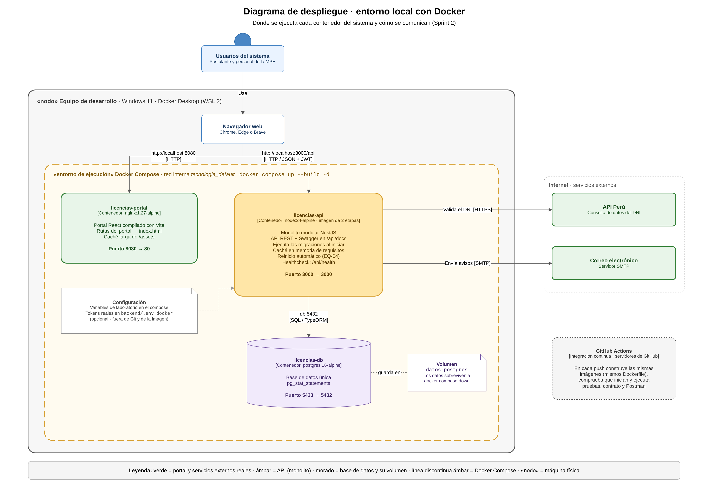

# Diagrama de despliegue

## Objetivo

Mostrar dónde se ejecuta cada contenedor del sistema, cómo se comunican y qué puertos expone. Esta versión corresponde al **entorno local con Docker** del Sprint 2 (ADR-010, Guía 06). El despliegue en la nube, con dominio, HTTPS y CDN, se agrega en el Sprint 3.

Fuente editable: [`img/fuentes/despliegue-local.drawio`](../../img/fuentes/despliegue-local.drawio).

## Elementos

| Elemento | Tipo | Qué hace | Puerto en el equipo |
|---|---|---|---|
| Equipo de desarrollo | Nodo (máquina física) | Windows 11 con Docker Desktop (WSL 2) | — |
| Navegador web | Cliente | Carga el portal y llama a la API | — |
| `licencias-portal` | Contenedor `nginx:1.27-alpine` | Sirve el portal React ya compilado. Devuelve `index.html` en las rutas del portal y guarda en caché los archivos de `/assets` | 8080 → 80 |
| `licencias-api` | Contenedor `node:24-alpine` | Monolito modular NestJS: API REST y Swagger. Ejecuta las migraciones al iniciar y se reinicia solo si el proceso cae (EQ-04) | 3000 → 3000 |
| `licencias-db` | Contenedor `postgres:16-alpine` | Base de datos única del sistema (ADR-005) | 5433 → 5432 |
| `datos-postgres` | Volumen | Conserva los datos aunque se eliminen los contenedores | — |
| API Perú y servidor SMTP | Servicios externos | Validación del DNI y envío de avisos | — |
| GitHub Actions | Integración continua | En cada push construye las mismas imágenes y comprueba que inician | — |

## Comunicación

| Origen | Destino | Dirección | Protocolo |
|---|---|---|---|
| Navegador | Portal | `http://localhost:8080` | HTTP |
| Navegador | API | `http://localhost:3000/api` | HTTP · JSON · JWT |
| API | PostgreSQL | `db:5432` (nombre del servicio en la red de Compose) | SQL · TypeORM |
| API | API Perú | `https://apiperu.dev/api` | HTTPS |
| API | Correo | Servidor SMTP configurado | SMTP |

El navegador llama a la API desde el equipo, por eso el portal usa `localhost:3000`. Dentro de la red de Compose, la API llega a la base por el nombre del servicio, `db`. Usar `localhost` ahí apuntaría al propio contenedor de la API.

## Decisiones

| Decisión | Motivo |
|---|---|
| Imágenes en dos etapas | La imagen final no lleva el código TypeScript ni las dependencias de desarrollo: es más liviana y expone menos |
| Migraciones al iniciar la API | El entorno queda listo con `docker compose up`, sin ejecutar scripts SQL a mano |
| PostgreSQL en el puerto 5433 del equipo | Deja libre el 5432 para un PostgreSQL instalado localmente |
| Credenciales de laboratorio en el compose y tokens reales en `.env.docker` | El entorno funciona sin preparación previa y ningún secreto real llega a Git ni a la imagen |
| Nginx para el portal | Sirve archivos estáticos con caché y compresión sin necesitar Node.js en ejecución |

## Ejecutar

Ver [tecnologia/README.md → Docker](../../tecnologia/README.md#docker).
