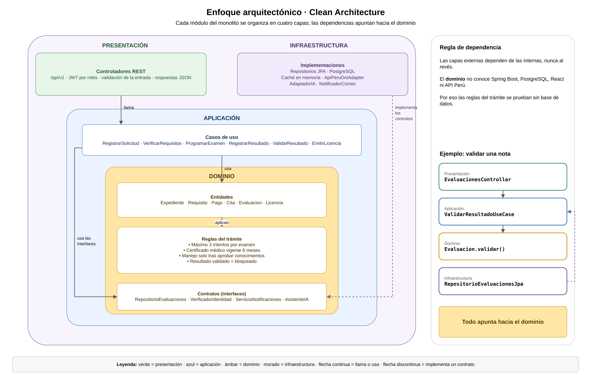

# Enfoque arquitectónico

## Clean Architecture

| Elemento | Descripción aplicada al sistema |
|---|---|
| **Patrón / enfoque arquitectónico** | Clean Architecture (Arquitectura Limpia). |
| **Objetivo** | Separar responsabilidades y dirigir las dependencias hacia el dominio. |
| **¿Qué problema resuelve?** | Evita el acoplamiento entre el portal React, las reglas del trámite y las tecnologías externas: PostgreSQL, API Perú, la IA y el correo. |
| **Capas definidas** | Presentación, Aplicación, Dominio e Infraestructura. |
| **Reglas del dominio** | Máximo 3 intentos por examen, vigencia de 6 meses del certificado médico, manejo solo después de aprobar conocimientos y bloqueo de resultados validados. |
| **Beneficios** | Facilita el mantenimiento y las pruebas unitarias. Permite cambiar un proveedor externo sin modificar las reglas del trámite. |

## Diagrama del enfoque arquitectónico

> Archivo editable: `img/fuentes/diagrama-clean-architecture.drawio`

## Contratos y adaptadores

| Contrato del dominio | Implementación en infraestructura |
|---|---|
| `RepositorioEvaluaciones` | Spring Data JPA y PostgreSQL |
| `VerificadorIdentidad` | `ApiPeruDniAdapter` (API Perú) |
| `AsistenteIA` | `AdaptadorIA` |
| `ServicioNotificaciones` | `NotificadorCorreo` (SMTP) |
