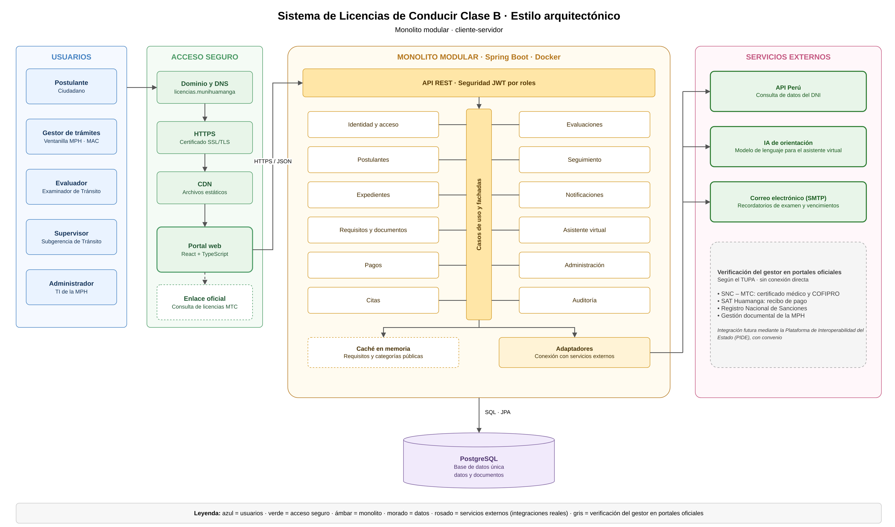

# Estilo arquitectónico del sistema

## Monolito modular cliente-servidor

El sistema es una sola aplicación backend (Spring Boot) dividida en 12 módulos, con un portal web en React y una base de datos PostgreSQL.

Se eligió porque es una sola municipalidad, el equipo es pequeño y un mismo trámite usa varios módulos a la vez (RC08, ADR-001).

## Diagrama del estilo arquitectónico

> Archivo editable: `img/fuentes/estilo-arquitectonico.drawio`
