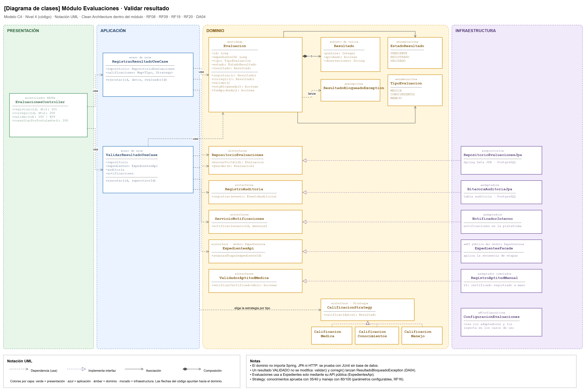
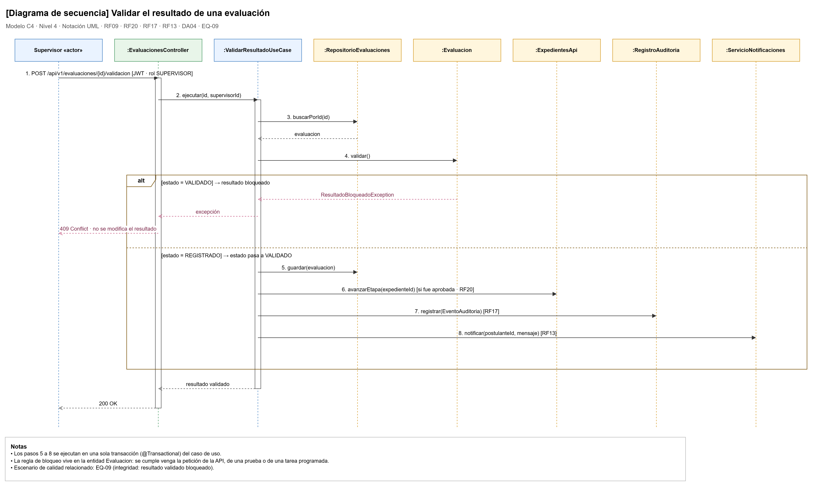

# Diseño interno de módulos

> **Proyecto:** Sistema de Licencias de Conducir Clase B · **Backend:** Java + Spring Boot · **Módulo de referencia:** Evaluaciones  
> **Enfoque arquitectónico:** Clean Architecture dentro de cada módulo del monolito modular  
> **Nivel C4:** 4 – Código · **Versión:** 1.0

---

## 1. Propósito

Este documento describe **cómo se organiza el código dentro de un módulo** del backend. Tiene tres objetivos:

1. Definir una estructura de paquetes común para los 12 módulos.
2. Mostrar cómo se aplica Clean Architecture en un módulo real.
3. Servir de guía para programar los demás módulos de la misma forma.

Se eligió **Evaluaciones** como módulo de referencia porque contiene la regla más crítica del sistema: un resultado validado por el supervisor no puede modificarse (RF09, DA04, EQ-09). Además, se comunica con Expedientes, Auditoría, Notificaciones y con el centro médico simulado.

---

## 2. Estructura de paquetes

Todos los módulos siguen la misma estructura. Ejemplo con Evaluaciones:

```text
backend/src/main/java/pe/licencias/
├── compartido/                              # excepciones base y utilidades comunes
└── evaluaciones/
    ├── presentacion/
    │   ├── EvaluacionesController.java      # endpoints REST /api/v1/evaluaciones
    │   └── dto/                             # RegistrarResultadoRequest, ResultadoResponse
    ├── aplicacion/
    │   ├── RegistrarResultadoUseCase.java
    │   ├── CorregirResultadoUseCase.java
    │   └── ValidarResultadoUseCase.java
    ├── dominio/
    │   ├── modelo/
    │   │   ├── Evaluacion.java              # entidad con las reglas de bloqueo
    │   │   ├── Resultado.java               # objeto de valor
    │   │   ├── EstadoResultado.java         # PENDIENTE, REGISTRADO, VALIDADO
    │   │   ├── TipoEvaluacion.java          # MEDICA, CONOCIMIENTOS, MANEJO
    │   │   └── ResultadoBloqueadoException.java
    │   ├── calificacion/                    # patrón Strategy
    │   │   ├── CalificacionStrategy.java
    │   │   ├── CalificacionMedica.java
    │   │   ├── CalificacionConocimientos.java
    │   │   └── CalificacionManejo.java
    │   └── contratos/                       # interfaces que la infraestructura implementa
    │       ├── RepositorioEvaluaciones.java
    │       ├── RegistroAuditoria.java
    │       ├── ServicioNotificaciones.java
    │       ├── ExpedientesApi.java
    │       └── ValidadorAptitudMedica.java
    ├── infraestructura/
    │   ├── RepositorioEvaluacionesJpa.java
    │   ├── EvaluacionEntidadJpa.java        # tabla evaluaciones
    │   ├── BitacoraAuditoriaJpa.java        # implementa RegistroAuditoria
    │   ├── NotificadorInterno.java          # implementa ServicioNotificaciones
    │   └── RegistroAptitudManual.java       # adaptador simulado del centro médico
    └── ConfiguracionEvaluaciones.java       # raíz de composición (@Configuration)
```

---

## 3. Capas del módulo y regla de dependencia

| Capa | Contiene | Puede depender de | No puede depender de |
|---|---|---|---|
| **Presentación** | Controlador REST y DTO | Aplicación | Infraestructura |
| **Aplicación** | Casos de uso | Dominio | Spring Web, JPA, proveedores externos |
| **Dominio** | Entidades, objetos de valor, enumeraciones, estrategias y contratos | Nada | Ninguna otra capa |
| **Infraestructura** | Repositorios JPA y adaptadores | Dominio (implementa sus contratos) | Presentación |

> **Regla de dependencia:** las dependencias del código apuntan hacia el dominio. La infraestructura implementa los contratos del dominio y la clase `ConfiguracionEvaluaciones` conecta cada contrato con su implementación.

---

## 4. Diagrama de clases



> Archivo editable: `img/fuentes/nivel4-clases.drawio`

### 4.1 Notación UML utilizada

| Símbolo | Significado | Ejemplo |
|---|---|---|
| Flecha discontinua con punta abierta | Dependencia (usa) | `ValidarResultadoUseCase` usa `RepositorioEvaluaciones` |
| Flecha discontinua con triángulo hueco | Implementa una interfaz | `RepositorioEvaluacionesJpa` implementa `RepositorioEvaluaciones` |
| Flecha continua | Asociación | `Evaluacion` tiene un `EstadoResultado` |
| Rombo relleno | Composición | `Evaluacion` contiene un `Resultado` |
| `«interface»`, `«entidad»`, `«caso de uso»` | Estereotipo: indica el rol de la clase | — |

---

## 5. Flujo de ejecución: validar un resultado



> Archivo editable: `img/fuentes/nivel4-secuencia.drawio`

1. El supervisor envía `POST /api/v1/evaluaciones/{id}/validacion` con su token JWT.
2. `EvaluacionesController` comprueba el rol `SUPERVISOR` (RF01) y llama a `ValidarResultadoUseCase`.
3. El caso de uso obtiene la evaluación mediante `RepositorioEvaluaciones`.
4. La entidad `Evaluacion` ejecuta `validar()`:
   - Si ya estaba **VALIDADO**, lanza `ResultadoBloqueadoException` y la API responde **409 Conflict** (EQ-09).
   - Si estaba **REGISTRADO**, cambia a **VALIDADO** y queda bloqueada.
5. El caso de uso guarda la evaluación.
6. Si el resultado fue aprobado, solicita a Expedientes avanzar a la siguiente etapa (RF20).
7. Registra la operación en auditoría (RF17).
8. Notifica al postulante (RF13) y responde **200 OK**.

---

## 6. Código de referencia

### 6.1 Dominio · entidad y contrato

```java
public class Evaluacion {
    private Long id;
    private Long expedienteId;
    private TipoEvaluacion tipo;
    private EstadoResultado estado = EstadoResultado.PENDIENTE;
    private Resultado resultado;

    public void registrar(Resultado nuevo) {
        if (estado == EstadoResultado.VALIDADO) throw new ResultadoBloqueadoException(id);
        this.resultado = nuevo;
        this.estado = EstadoResultado.REGISTRADO;
    }

    public void corregir(Resultado corregido) {
        registrar(corregido);                       // misma regla: solo antes de validar (RF09)
    }

    public void validar() {
        if (estado == EstadoResultado.VALIDADO) throw new ResultadoBloqueadoException(id);
        if (estado != EstadoResultado.REGISTRADO) throw new IllegalStateException("No hay resultado registrado");
        this.estado = EstadoResultado.VALIDADO;     // a partir de aquí queda bloqueado (DA04)
    }

    public boolean fueAprobada() { return resultado != null && resultado.aprobado(); }
    public boolean estaBloqueada() { return estado == EstadoResultado.VALIDADO; }
}
```

```java
public interface RepositorioEvaluaciones {
    Evaluacion buscarPorId(Long id);
    void guardar(Evaluacion evaluacion);
}
```

### 6.2 Aplicación · caso de uso

```java
public class ValidarResultadoUseCase {
    private final RepositorioEvaluaciones repositorio;
    private final ExpedientesApi expedientes;
    private final RegistroAuditoria auditoria;
    private final ServicioNotificaciones notificaciones;

    public ValidarResultadoUseCase(RepositorioEvaluaciones repositorio, ExpedientesApi expedientes,
                                   RegistroAuditoria auditoria, ServicioNotificaciones notificaciones) {
        this.repositorio = repositorio;
        this.expedientes = expedientes;
        this.auditoria = auditoria;
        this.notificaciones = notificaciones;
    }

    @Transactional
    public Evaluacion ejecutar(Long evaluacionId, Long supervisorId) {
        Evaluacion evaluacion = repositorio.buscarPorId(evaluacionId);
        evaluacion.validar();
        repositorio.guardar(evaluacion);
        if (evaluacion.fueAprobada()) {
            expedientes.avanzarEtapa(evaluacion.getExpedienteId());
        }
        auditoria.registrar(EventoAuditoria.resultadoValidado(evaluacion, supervisorId));
        notificaciones.notificar(evaluacion.getPostulanteId(), "Tu resultado fue validado");
        return evaluacion;
    }
}
```

### 6.3 Infraestructura · repositorio

```java
@Repository
public class RepositorioEvaluacionesJpa implements RepositorioEvaluaciones {
    private final EvaluacionJpaRepository jpa;          // Spring Data JPA

    public RepositorioEvaluacionesJpa(EvaluacionJpaRepository jpa) { this.jpa = jpa; }

    @Override
    public Evaluacion buscarPorId(Long id) {
        return jpa.findById(id).map(EvaluacionEntidadJpa::aDominio)
                  .orElseThrow(() -> new EvaluacionNoEncontradaException(id));
    }

    @Override
    public void guardar(Evaluacion evaluacion) {
        jpa.save(EvaluacionEntidadJpa.desdeDominio(evaluacion));
    }
}
```

### 6.4 Presentación · controlador

```java
@RestController
@RequestMapping("/api/v1/evaluaciones")
public class EvaluacionesController {
    private final ValidarResultadoUseCase validarResultado;

    public EvaluacionesController(ValidarResultadoUseCase validarResultado) {
        this.validarResultado = validarResultado;
    }

    @PostMapping("/{id}/validacion")
    @PreAuthorize("hasRole('SUPERVISOR')")
    public ResponseEntity<ResultadoResponse> validar(@PathVariable Long id, @AuthenticationPrincipal Usuario supervisor) {
        Evaluacion evaluacion = validarResultado.ejecutar(id, supervisor.getId());
        return ResponseEntity.ok(ResultadoResponse.desde(evaluacion));
    }

    @ExceptionHandler(ResultadoBloqueadoException.class)
    public ResponseEntity<ErrorResponse> bloqueado(ResultadoBloqueadoException e) {
        return ResponseEntity.status(HttpStatus.CONFLICT).body(ErrorResponse.de(e.getMessage()));
    }
}
```

### 6.5 Raíz de composición

```java
@Configuration
public class ConfiguracionEvaluaciones {

    @Bean
    public ValidarResultadoUseCase validarResultadoUseCase(RepositorioEvaluaciones repositorio,
            ExpedientesApi expedientes, RegistroAuditoria auditoria, ServicioNotificaciones notificaciones) {
        return new ValidarResultadoUseCase(repositorio, expedientes, auditoria, notificaciones);
    }

    @Bean
    @Profile("simulado")                               // v1: sin centro médico real
    public ValidadorAptitudMedica validadorAptitud() {
        return new RegistroAptitudManual();
    }
}
```

> Para reemplazar el registro manual por un centro médico autorizado se crea un nuevo adaptador y se registra con otro perfil. El dominio y los casos de uso no cambian (DA08, EQ-06).
