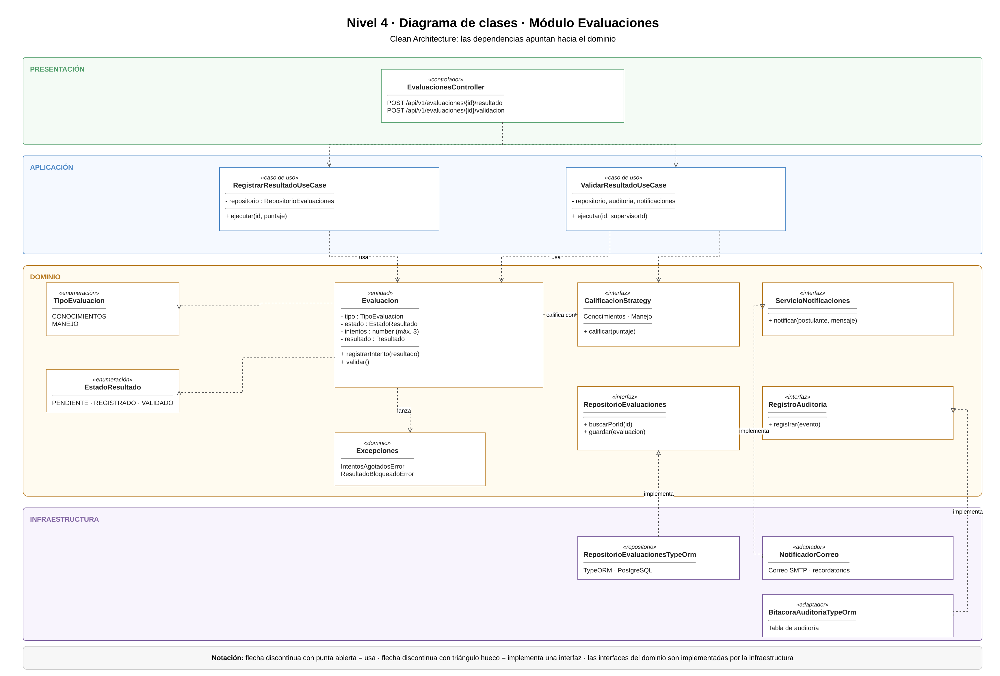
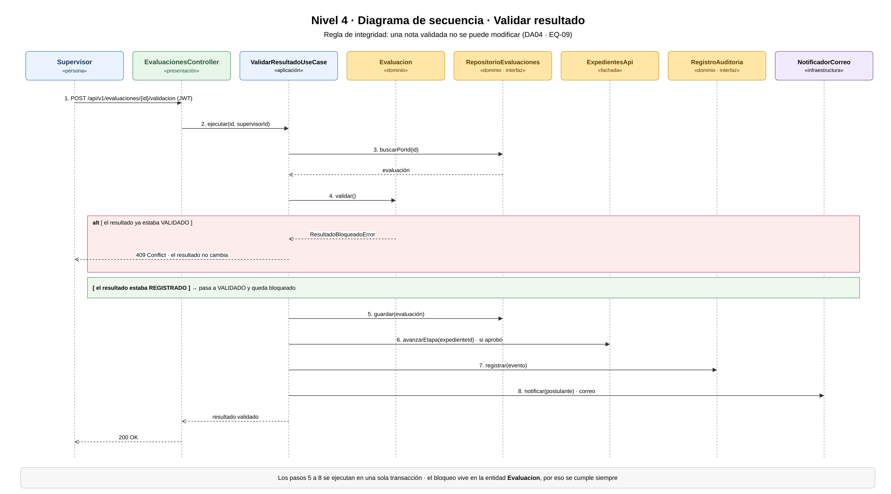

# Diseño interno de módulos

> **Proyecto:** Sistema de Licencias de Conducir Clase B · **Backend:** Node.js + NestJS (TypeScript) · **Módulo de referencia:** Evaluaciones  
> **Enfoque arquitectónico:** Clean Architecture dentro de cada módulo del monolito modular  
> **Nivel C4:** 4 – Código · **Versión:** 2.0

---

## 1. Propósito

Este documento describe **cómo se organiza el código dentro de un módulo** del backend. Tiene tres objetivos:

1. Definir una estructura de carpetas común para los 12 módulos.
2. Mostrar cómo se aplica Clean Architecture en un módulo real.
3. Servir de guía para programar los demás módulos de la misma forma.

Se eligió **Evaluaciones** como módulo de referencia porque contiene las reglas más críticas del sistema: un postulante tiene un máximo de 3 intentos por examen y un resultado validado por el supervisor no puede modificarse (RF08, RF09, DA04, EQ-09). Además, se comunica con Expedientes, Auditoría y Notificaciones, que envía los avisos por correo.

---

## 2. Estructura de carpetas

Todos los módulos siguen la misma estructura. Ejemplo con Evaluaciones:

```text
backend/src/
├── compartido/                                  # excepciones base, guardas de roles y utilidades
└── modulos/evaluaciones/
    ├── presentacion/
    │   ├── evaluaciones.controller.ts           # endpoints REST /api/v1/evaluaciones
    │   └── dto/                                 # registrar-resultado.dto.ts, resultado.response.ts
    ├── aplicacion/
    │   ├── registrar-resultado.use-case.ts
    │   ├── corregir-resultado.use-case.ts
    │   └── validar-resultado.use-case.ts
    ├── dominio/
    │   ├── modelo/
    │   │   ├── evaluacion.ts                    # entidad con las reglas de bloqueo
    │   │   ├── resultado.ts                     # objeto de valor
    │   │   ├── estado-resultado.ts              # PENDIENTE, REGISTRADO, VALIDADO
    │   │   ├── tipo-evaluacion.ts               # CONOCIMIENTOS, MANEJO
    │   │   └── errores.ts                       # IntentosAgotadosError, ResultadoBloqueadoError
    │   ├── calificacion/                        # patrón Strategy
    │   │   ├── calificacion.strategy.ts
    │   │   ├── calificacion-conocimientos.ts
    │   │   └── calificacion-manejo.ts
    │   └── contratos/                           # interfaces que la infraestructura implementa
    │       ├── repositorio-evaluaciones.ts
    │       ├── registro-auditoria.ts
    │       ├── servicio-notificaciones.ts
    │       └── expedientes-api.ts
    ├── infraestructura/
    │   ├── repositorio-evaluaciones.typeorm.ts
    │   ├── evaluacion.orm-entity.ts             # tabla evaluaciones
    │   ├── bitacora-auditoria.typeorm.ts        # implementa RegistroAuditoria
    │   └── notificador-correo.ts                # implementa ServicioNotificaciones (Nodemailer, SMTP)
    ├── evaluaciones.module.ts                   # raíz de composición del módulo
    └── __tests__/                               # pruebas Jest del módulo
```

---

## 3. Capas del módulo y regla de dependencia

| Capa | Contiene | Puede depender de | No puede depender de |
|---|---|---|---|
| **Presentación** | Controlador REST y DTO | Aplicación | Infraestructura |
| **Aplicación** | Casos de uso | Dominio | NestJS HTTP, TypeORM, proveedores externos |
| **Dominio** | Entidades, objetos de valor, enumeraciones, estrategias y contratos | Nada | Ninguna otra capa |
| **Infraestructura** | Repositorios TypeORM y adaptadores | Dominio (implementa sus contratos) | Presentación |

> **Regla de dependencia:** las dependencias del código apuntan hacia el dominio. La infraestructura implementa los contratos del dominio y el archivo `evaluaciones.module.ts` conecta cada contrato con su implementación.

---

## 4. Diagrama de clases



> Archivo editable: `img/fuentes/nivel4-clases.drawio`

### 4.1 Notación UML utilizada

| Símbolo | Significado | Ejemplo |
|---|---|---|
| Flecha discontinua con punta abierta | Dependencia (usa) | `ValidarResultadoUseCase` usa `RepositorioEvaluaciones` |
| Flecha discontinua con triángulo hueco | Implementa una interfaz | `RepositorioEvaluacionesTypeOrm` implementa `RepositorioEvaluaciones` |
| Flecha continua | Asociación | `Evaluacion` tiene un `EstadoResultado` |
| Rombo relleno | Composición | `Evaluacion` contiene un `Resultado` |
| `«interface»`, `«entidad»`, `«caso de uso»` | Estereotipo: indica el rol de la clase | — |

---

## 5. Flujo de ejecución: validar un resultado



> Archivo editable: `img/fuentes/nivel4-secuencia.drawio`

1. El supervisor envía `POST /api/v1/evaluaciones/{id}/validacion` con su token JWT.
2. `EvaluacionesController` comprueba el rol `SUPERVISOR` (RF01) y llama a `ValidarResultadoUseCase`.
3. El caso de uso obtiene la evaluación mediante `RepositorioEvaluaciones`.
4. La entidad `Evaluacion` ejecuta `validar()`:
   - Si ya estaba **VALIDADO**, lanza `ResultadoBloqueadoError` y la API responde **409 Conflict** (EQ-09).
   - Si estaba **REGISTRADO**, cambia a **VALIDADO** y queda bloqueada.
5. El caso de uso guarda la evaluación.
6. Si el resultado fue aprobado, solicita a Expedientes avanzar a la siguiente etapa (RF20).
7. Registra la operación en auditoría (RF17).
8. Notifica al postulante (RF13) y responde **200 OK**.

---

## 6. Código de referencia

### 6.1 Dominio · entidad y contrato

```ts
// dominio/modelo/evaluacion.ts — TypeScript puro, sin NestJS ni TypeORM
export class Evaluacion {
  static readonly MAXIMO_INTENTOS = 3;

  constructor(
    readonly id: number,
    readonly expedienteId: number,
    readonly postulanteId: number,
    readonly tipo: TipoEvaluacion,
    private estado: EstadoResultado = EstadoResultado.PENDIENTE,
    private resultado: Resultado | null = null,
    private intentos = 0,
  ) {}

  registrar(nuevo: Resultado): void {
    if (this.estado === EstadoResultado.VALIDADO) throw new ResultadoBloqueadoError(this.id);
    if (this.intentos >= Evaluacion.MAXIMO_INTENTOS) throw new IntentosAgotadosError(this.id); // RF08
    this.intentos++;
    this.resultado = nuevo;
    this.estado = EstadoResultado.REGISTRADO;
  }

  corregir(corregido: Resultado): void {
    if (this.estado === EstadoResultado.VALIDADO) throw new ResultadoBloqueadoError(this.id);
    this.resultado = corregido; // corrige sin consumir un intento (RF09)
  }

  validar(): void {
    if (this.estado === EstadoResultado.VALIDADO) throw new ResultadoBloqueadoError(this.id);
    if (this.estado !== EstadoResultado.REGISTRADO) throw new Error('No hay resultado registrado');
    this.estado = EstadoResultado.VALIDADO; // a partir de aquí queda bloqueado (DA04)
  }

  fueAprobada(): boolean { return this.resultado?.aprobado ?? false; }
  estaBloqueada(): boolean { return this.estado === EstadoResultado.VALIDADO; }
}
```

```ts
// dominio/contratos/repositorio-evaluaciones.ts
export interface RepositorioEvaluaciones {
  buscarPorId(id: number): Promise<Evaluacion>;
  guardar(evaluacion: Evaluacion): Promise<void>;
}
export const REPOSITORIO_EVALUACIONES = Symbol('RepositorioEvaluaciones'); // token de inyección
```

### 6.2 Aplicación · caso de uso

```ts
// aplicacion/validar-resultado.use-case.ts
@Injectable()
export class ValidarResultadoUseCase {
  constructor(
    @Inject(REPOSITORIO_EVALUACIONES) private readonly repositorio: RepositorioEvaluaciones,
    @Inject(EXPEDIENTES_API) private readonly expedientes: ExpedientesApi,
    @Inject(REGISTRO_AUDITORIA) private readonly auditoria: RegistroAuditoria,
    @Inject(SERVICIO_NOTIFICACIONES) private readonly notificaciones: ServicioNotificaciones,
  ) {}

  async ejecutar(evaluacionId: number, supervisorId: number): Promise<Evaluacion> {
    const evaluacion = await this.repositorio.buscarPorId(evaluacionId);
    evaluacion.validar();
    await this.repositorio.guardar(evaluacion);
    if (evaluacion.fueAprobada()) await this.expedientes.avanzarEtapa(evaluacion.expedienteId);
    await this.auditoria.registrar(EventoAuditoria.resultadoValidado(evaluacion, supervisorId));
    await this.notificaciones.notificar(evaluacion.postulanteId, 'Tu resultado fue validado');
    return evaluacion;
  }
}
```

### 6.3 Infraestructura · repositorio

```ts
// infraestructura/repositorio-evaluaciones.typeorm.ts
@Injectable()
export class RepositorioEvaluacionesTypeOrm implements RepositorioEvaluaciones {
  constructor(@InjectRepository(EvaluacionOrmEntity) private readonly orm: Repository<EvaluacionOrmEntity>) {}

  async buscarPorId(id: number): Promise<Evaluacion> {
    const fila = await this.orm.findOneBy({ id });
    if (!fila) throw new EvaluacionNoEncontradaError(id);
    return fila.aDominio();
  }

  async guardar(evaluacion: Evaluacion): Promise<void> {
    await this.orm.save(EvaluacionOrmEntity.desdeDominio(evaluacion));
  }
}
```

### 6.4 Presentación · controlador

```ts
// presentacion/evaluaciones.controller.ts
@ApiTags('Evaluaciones')
@ApiBearerAuth()
@Controller('api/v1/evaluaciones')
export class EvaluacionesController {
  constructor(private readonly validarResultado: ValidarResultadoUseCase) {}

  @Post(':id/validacion')
  @Roles(Rol.SUPERVISOR)                       // RF01: solo el supervisor
  @ApiOkResponse({ type: ResultadoResponse })
  @ApiConflictResponse({ description: 'El resultado ya fue validado' })
  async validar(@Param('id', ParseIntPipe) id: number, @UsuarioActual() supervisor: Usuario) {
    const evaluacion = await this.validarResultado.ejecutar(id, supervisor.id);
    return ResultadoResponse.desde(evaluacion);
  }
}

// compartido/filtro-errores-dominio.ts: convierte ResultadoBloqueadoError en 409 Conflict
@Catch(ResultadoBloqueadoError)
export class ResultadoBloqueadoFilter implements ExceptionFilter {
  catch(error: ResultadoBloqueadoError, host: ArgumentsHost) {
    host.switchToHttp().getResponse().status(409).json({ mensaje: error.message });
  }
}
```

### 6.5 Raíz de composición

```ts
// evaluaciones.module.ts
@Module({
  imports: [TypeOrmModule.forFeature([EvaluacionOrmEntity]), ExpedientesModule, AuditoriaModule],
  controllers: [EvaluacionesController],
  providers: [
    ValidarResultadoUseCase,
    { provide: REPOSITORIO_EVALUACIONES, useClass: RepositorioEvaluacionesTypeOrm },
    { provide: SERVICIO_NOTIFICACIONES, useClass: NotificadorCorreo }, // recordatorios por SMTP (ADR-013)
  ],
})
export class EvaluacionesModule {}
```

> Para cambiar el envío de avisos, por ejemplo a otro proveedor de correo, se crea un nuevo adaptador de `ServicioNotificaciones` y se cambia solo la línea `useClass` del módulo. El dominio y los casos de uso no cambian (DA08, EQ-06).

### 6.6 Prueba con Jest de la regla de bloqueo

```ts
// __tests__/evaluacion.spec.ts — prueba del dominio, sin base de datos
describe('Evaluacion', () => {
  it('rechaza modificar un resultado validado (RF09, EQ-09)', () => {
    const evaluacion = new Evaluacion(1, 10, 100, TipoEvaluacion.CONOCIMIENTOS);
    evaluacion.registrar(new Resultado(16, true));
    evaluacion.validar();
    expect(() => evaluacion.corregir(new Resultado(20, true))).toThrow(ResultadoBloqueadoError);
  });

  it('rechaza el cuarto intento (RF08)', () => {
    const evaluacion = new Evaluacion(1, 10, 100, TipoEvaluacion.MANEJO);
    for (let i = 0; i < 3; i++) evaluacion.registrar(new Resultado(8, false));
    expect(() => evaluacion.registrar(new Resultado(15, true))).toThrow(IntentosAgotadosError);
  });
});
```
