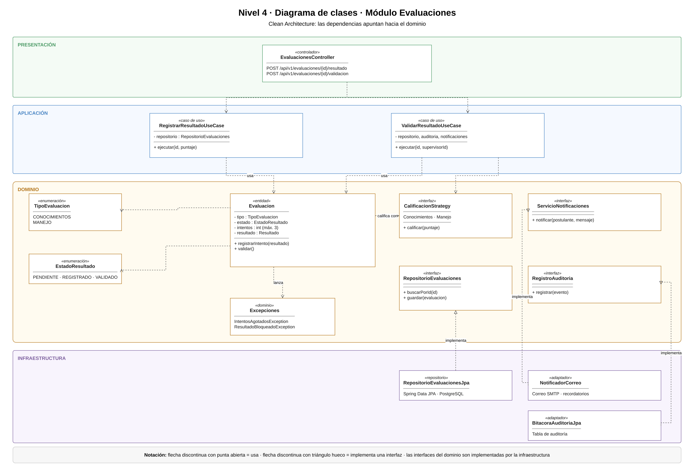

# Principios de diseño (SOLID)

## Objetivo

Documentar cómo se aplican los principios SOLID en el backend del Sistema de Licencias Clase B, organizado con Clean Architecture, para que cada módulo se programe de forma uniforme y las reglas del trámite no dependan de la tecnología.

## Contexto

- **Estilo:** monolito modular (Java + Spring Boot).
- **Enfoque interno:** Clean Architecture (presentación, aplicación, dominio, infraestructura).
- **Módulo de referencia:** Evaluaciones, porque contiene las reglas de los 3 intentos y del bloqueo de resultados (DA04) y se integra con Expedientes, Auditoría y Notificaciones.

## SOLID en el módulo Evaluaciones

| Principio | Dónde se aplica (capa) | Cómo se cumple en el sistema | Clases |
|---|---|---|---|
| **S** · Responsabilidad única | Todas las capas | Cada clase tiene una sola tarea: el controlador recibe la petición HTTP, el caso de uso coordina la validación, la entidad aplica las reglas y el repositorio guarda en PostgreSQL | `EvaluacionesController`, `ValidarResultadoUseCase`, `Evaluacion`, `RepositorioEvaluacionesJpa` |
| **O** · Abierto/cerrado | Dominio e infraestructura | Para cambiar el envío de avisos se crea un nuevo adaptador; para un nuevo tipo de examen se crea una nueva estrategia. El caso de uso no se modifica | `NotificadorCorreo`, `CalificacionStrategy` y sus implementaciones |
| **L** · Sustitución de Liskov | Dominio e infraestructura | `CalificacionConocimientos` y `CalificacionManejo` devuelven siempre un resultado; el caso de uso funciona igual con cualquiera. Lo mismo ocurre con cualquier implementación de `ServicioNotificaciones` | `CalificacionStrategy`, `ServicioNotificaciones` |
| **I** · Segregación de interfaces | Dominio | Cada contrato tiene solo lo necesario: `RepositorioEvaluaciones` guarda y busca, `RegistroAuditoria` solo registra, `ServicioNotificaciones` solo notifica, `ExpedientesApi` solo avanza la etapa | `RepositorioEvaluaciones`, `RegistroAuditoria`, `ServicioNotificaciones`, `ExpedientesApi` |
| **D** · Inversión de dependencias | Aplicación | El caso de uso recibe interfaces por el constructor y no conoce PostgreSQL, el servidor de correo ni el módulo Expedientes; las implementaciones se conectan en `ConfiguracionEvaluaciones` | `ValidarResultadoUseCase`, `ConfiguracionEvaluaciones` |

## Qué pasaría sin SOLID en el sistema

| Situación real | Sin SOLID | Con SOLID |
|---|---|---|
| Se cambia el proveedor de correo | Hay que modificar el caso de uso | Solo se crea un nuevo adaptador de `ServicioNotificaciones` |
| Cambia la nota mínima del examen de conocimientos | Se busca el número en controladores y servicios | Solo cambia el parámetro usado por `CalificacionConocimientos` |
| Se quiere probar la regla de los 3 intentos | Se necesita PostgreSQL y el servidor | Se prueba la entidad `Evaluacion` con JUnit, sin base de datos |
| Se integra el SNC mediante la PIDE | Se modifican varios módulos | Se crea un nuevo adaptador del contrato correspondiente |
| Cambia la regla de bloqueo | Está repartida en varias capas | Está solo en la entidad `Evaluacion` |

## Relación con Clean Architecture y los patrones

| Principio | Lo cumple en el proyecto |
|---|---|
| Responsabilidad única | La separación en capas de Clean Architecture |
| Abierto/cerrado y Liskov | Los patrones Adapter (API Perú, IA y correo) y Strategy (calificación) |
| Segregación de interfaces | Los contratos pequeños del dominio |
| Inversión de dependencias | El patrón Repository y la regla de dependencia: las capas externas dependen del dominio |
