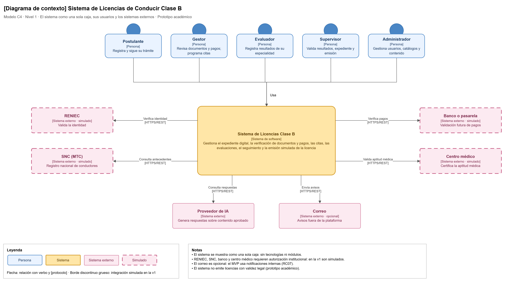

# Nivel 1 · Diagrama de contexto del sistema

> **Proyecto:** Sistema de Licencias de Conducir Clase B  
> **Modelo:** C4 · Nivel 1 de 4 · **Versión:** 1.0

---

## 1. Objetivo

Mostrar el **Sistema de Licencias Clase B como una sola caja**: quiénes lo usan y con qué sistemas externos se comunica. Es la vista de mayor nivel y la primera que se presenta a cualquier persona, técnica o no.

| Aspecto | Descripción |
|---|---|
| Pregunta que responde | ¿Qué es el sistema, quién lo usa y con quién se integra? |
| Audiencia | Todos: docentes, municipalidad, equipo de desarrollo, operaciones |
| Qué **no** muestra | Tecnologías, servidores, bases de datos ni módulos internos |
| Siguiente nivel | `Nivel2-DiagramadeContenedores.md` |

---

## 2. Diagrama

> Archivo editable: `img/fuentes/nivel1-contexto.drawio`

---

## 3. Personas (usuarios)

| Persona | Descripción | Qué hace en el sistema | Requisitos |
|---|---|---|---|
| **Postulante** | Ciudadano que tramita su licencia clase B (II-B o II-C) | Registra su solicitud, adjunta documentos y pagos, consulta citas, resultados y el avance de su trámite, y usa el asistente virtual | RF02, RF03, RF05, RF10, RF14, RF19 |
| **Gestor de trámites** | Personal que revisa los expedientes | Verifica identidad, documentos y pagos, programa citas y responde consultas derivadas | RF04, RF06, RF07 |
| **Evaluador** | Personal de evaluación médica, de conocimientos o de manejo | Registra y corrige resultados de su especialidad antes de la validación | RF08, RF09 |
| **Supervisor** | Responsable de validar el proceso | Valida resultados y expedientes, y autoriza la emisión simulada | RF09, RF11, RF12 |
| **Administrador** | Responsable de la configuración del sistema | Gestiona usuarios, roles, categorías, requisitos, parámetros, jornadas, horarios, cupos, contenidos, reportes y auditoría | RF16, RF17, RF18, RF21 |

---

## 4. Sistemas

| Sistema | Tipo | Responsabilidad | Primera versión |
|---|---|---|---|
| **Sistema de Licencias Clase B** | Sistema en alcance | Gestiona el expediente digital, la verificación de documentos y pagos, las citas, las evaluaciones, el seguimiento y la emisión simulada | Construido por el equipo |
| **RENIEC** | Sistema externo | Valida la identidad del postulante | Simulado; verificación manual del gestor |
| **SNC (MTC)** | Sistema externo | Registro nacional de conductores | Simulado |
| **Banco o pasarela** | Sistema externo | Valida los pagos del derecho de trámite | Simulado; verificación manual del comprobante |
| **Centro médico** | Sistema externo | Certifica la aptitud médica | Simulado; registro manual del certificado |
| **Proveedor de IA** | Sistema externo | Genera respuestas sobre el contenido aprobado | Controlado por el contenido del administrador |
| **Correo** | Sistema externo | Envía avisos fuera de la plataforma | Opcional; el MVP usa notificaciones internas |

---

## 5. Relaciones

| Origen | Destino | Descripción | Protocolo |
|---|---|---|---|
| Postulante, Gestor, Evaluador, Supervisor, Administrador | Sistema de Licencias | Usan el sistema según su rol | — |
| Sistema de Licencias | RENIEC | Verifica la identidad | HTTPS/REST (simulado) |
| Sistema de Licencias | SNC (MTC) | Consulta antecedentes del conductor | HTTPS/REST (simulado) |
| Sistema de Licencias | Banco o pasarela | Verifica pagos | HTTPS/REST (simulado) |
| Sistema de Licencias | Centro médico | Valida la aptitud médica | HTTPS/REST (simulado) |
| Sistema de Licencias | Proveedor de IA | Consulta respuestas | HTTPS/REST |
| Sistema de Licencias | Correo | Envía avisos | HTTPS/REST o SMTP |

> En el nivel 1 no se indica el protocolo entre las personas y el sistema: eso se detalla en el nivel 2.

---

## 6. Decisiones y supuestos

| # | Decisión o supuesto | Motivo |
|---|---|---|
| 1 | RENIEC, SNC, banco y centro médico se representan con **adaptadores simulados** | Su integración real requiere autorización institucional (RC02, RC03, RC04) |
| 2 | El sistema **no emite licencias con validez legal** | Es un prototipo académico; la emisión se registra de forma simulada (RF12, RC05) |
| 3 | Los sistemas externos no se modifican | Son de terceros; el sistema se adapta a ellos mediante adaptadores (ADR-007) |
| 4 | El asistente virtual solo usa contenido aprobado | No aprueba trámites ni modifica información (RC06, DA07) |

### Pendientes por definir

| Tema | Detalle |
|---|---|
| Canal de notificaciones externas | Definir si el correo se implementará en la v1 o si se mantienen solo las notificaciones internas |
| Convenios institucionales | Las integraciones reales con RENIEC, SNC, bancos y centros médicos dependen de una autorización formal |
