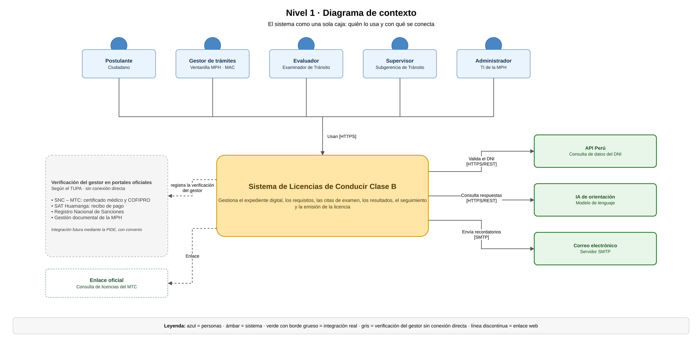

# Nivel 1 · Diagrama de contexto del sistema

## Objetivo

Mostrar el sistema como una sola caja: quiénes lo usan y con qué sistemas externos se comunica.

## Diagrama

> Archivo editable: `img/fuentes/nivel1-contexto.drawio`

## Personas

| Persona | Quién es | Qué hace en el sistema |
|---|---|---|
| **Postulante** | Ciudadano que tramita su licencia II-B o II-C | Registra su solicitud, sube documentos, elige su cita y sigue su trámite |
| **Gestor de trámites** | Ventanilla de la MPH en el MAC | Verifica DNI, documentos y pago; reprograma citas |
| **Evaluador** | Examinador de Tránsito | Registra los resultados de los exámenes (máximo 3 intentos) |
| **Supervisor** | Subgerencia de Tránsito | Valida el expediente y autoriza la emisión |
| **Administrador** | TI de la MPH | Gestiona usuarios, requisitos, días de examen y cupos |

## Sistemas externos

| Sistema | Tipo | Uso |
|---|---|---|
| **API Perú** | Integración real | Consulta del DNI |
| **IA de orientación** | Integración real | Respuestas del asistente virtual |
| **Correo electrónico** | Integración real | Recordatorios de examen y vencimientos |
| **SNC, SAT y Registro Nacional de Sanciones** | Verificación del gestor | El gestor los consulta en sus portales oficiales |
