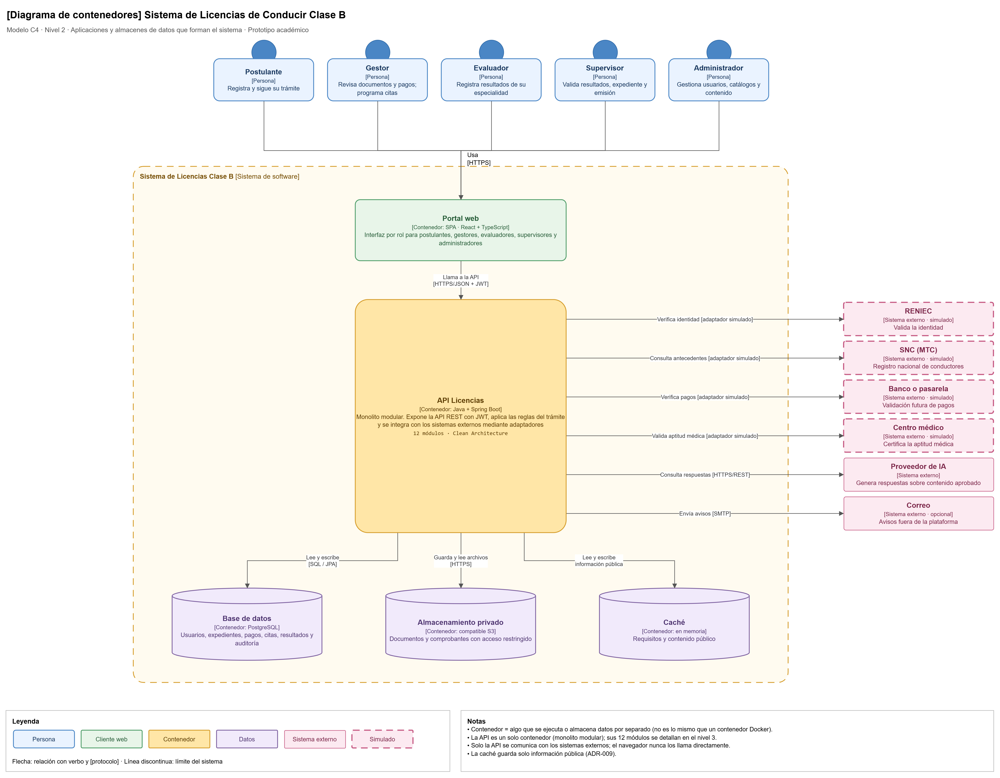

# Nivel 2 · Diagrama de contenedores

> **Proyecto:** Sistema de Licencias de Conducir Clase B  
> **Modelo:** C4 · Nivel 2 de 4 · **Versión:** 1.0

---

## 1. Objetivo

Abrir la caja «Sistema de Licencias Clase B» del nivel 1 y mostrar los **contenedores** que la forman: las aplicaciones y almacenes de datos que se ejecutan por separado, la tecnología de cada uno y cómo se comunican.

| Aspecto | Descripción |
|---|---|
| Pregunta que responde | ¿De qué piezas ejecutables se compone el sistema y con qué tecnología? |
| Audiencia | Arquitectos, desarrolladores, operaciones |
| Qué es un contenedor | Algo que se ejecuta o almacena datos de forma independiente: una aplicación web, una API, una base de datos (no es lo mismo que un contenedor Docker) |
| Nivel anterior | `Nivel1-DiagramadeContextodelSistema.md` |
| Siguiente nivel | `Nivel3-Diagrama-de-Componentes.md` |

---

## 2. Diagrama

> Archivo editable: `img/fuentes/nivel2-contenedores.drawio`

---

## 3. Contenedores

| Contenedor | Tecnología | Responsabilidad | Datos que maneja |
|---|---|---|---|
| **Portal web** | SPA · React + TypeScript | Interfaz por rol para postulantes, gestores, evaluadores, supervisores y administradores. Se ejecuta en el navegador | Ninguno persistente; solo el estado de la pantalla y el token de sesión |
| **API Licencias** | Java + Spring Boot | Expone la API REST con JWT, aplica las reglas del trámite e integra los sistemas externos mediante adaptadores. Es un **monolito modular**: un solo proceso con 12 módulos internos organizados con Clean Architecture | Ninguno propio; usa la base de datos, el almacenamiento y la caché |
| **Base de datos** | PostgreSQL | Almacena de forma permanente la información del trámite | Usuarios, expedientes, pagos, citas, resultados, notificaciones y auditoría |
| **Almacenamiento privado** | Compatible con S3 | Guarda los archivos con acceso restringido | Documentos de identidad, fotografías, declaraciones y comprobantes |
| **Caché** | En memoria | Guarda la información pública más consultada para responder más rápido | Categorías, requisitos y contenido informativo |

---

## 4. Relaciones

| Origen | Destino | Descripción | Protocolo |
|---|---|---|---|
| Postulante, Gestor, Evaluador, Supervisor, Administrador | Portal web | Usan la aplicación desde el navegador | HTTPS |
| Portal web | API Licencias | Llama a la API | HTTPS/JSON + JWT |
| API Licencias | Base de datos | Lee y escribe información | SQL / JPA |
| API Licencias | Almacenamiento privado | Guarda y lee archivos | HTTPS |
| API Licencias | Caché | Lee y escribe información pública | En memoria |
| API Licencias | RENIEC | Verifica la identidad | Adaptador simulado |
| API Licencias | SNC (MTC) | Consulta antecedentes | Adaptador simulado |
| API Licencias | Banco o pasarela | Verifica pagos | Adaptador simulado |
| API Licencias | Centro médico | Valida la aptitud médica | Adaptador simulado |
| API Licencias | Proveedor de IA | Consulta respuestas | HTTPS/REST |
| API Licencias | Correo | Envía avisos (opcional) | SMTP |

---

## 5. Decisiones arquitectónicas reflejadas

| Decisión | Alternativa descartada | Motivo |
|---|---|---|
| Un único contenedor de backend (monolito modular) | Microservicios | Equipo pequeño y plazo académico; los módulos permiten separar servicios en el futuro si es necesario (ADR-001) |
| Frontend separado del backend (SPA + API REST) | Páginas generadas en el servidor | El frontend y el backend evolucionan y se despliegan de forma independiente (ADR-003) |
| PostgreSQL como base de datos | Base de datos NoSQL | Expedientes, pagos, cupos y resultados necesitan transacciones y consistencia (ADR-005) |
| Almacenamiento privado para documentos | Guardar archivos en la base de datos o en una carpeta pública | Los documentos contienen datos personales y médicos (ADR-008, DA02) |
| Caché solo para información pública | Cachear también datos personales | Mejora el tiempo de respuesta sin exponer información sensible (ADR-009) |
| Solo la API se comunica con los sistemas externos | Llamar a los servicios desde el navegador | Las credenciales y los adaptadores quedan en el servidor (ADR-007) |

---

## 6. Seguridad entre contenedores

| Comunicación | Medida |
|---|---|
| Navegador → Portal web y API | Tráfico cifrado con HTTPS (ADR-011) |
| Portal web → API | Autenticación con token JWT y autorización por rol en cada petición (ADR-004) |
| API → Base de datos, almacenamiento y caché | Acceso solo desde la red interna; credenciales en variables de entorno |
| API → Almacenamiento privado | Documentos accesibles solo mediante enlaces temporales o autorizados |
| API → Sistemas externos | Credenciales de cada proveedor guardadas solo en el servidor |
