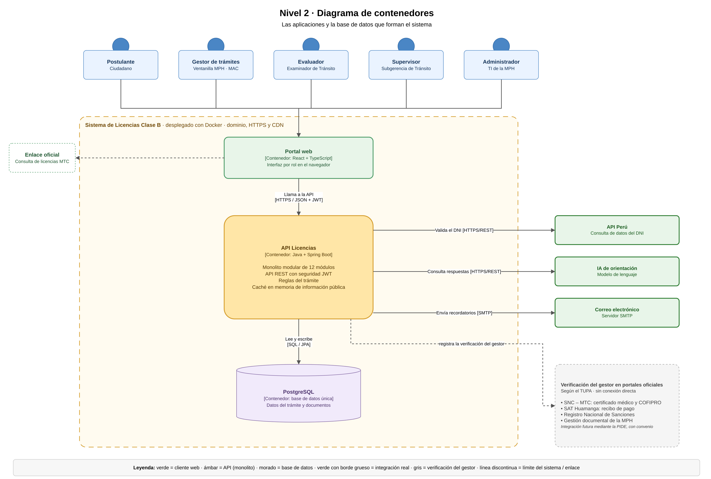

# Nivel 2 · Diagrama de contenedores

## Objetivo

Mostrar las piezas que se ejecutan por separado, su tecnología y cómo se comunican.

## Diagrama

> Archivo editable: `img/fuentes/nivel2-contenedores.drawio`

## Contenedores

| Contenedor | Tecnología | Responsabilidad |
|---|---|---|
| **Portal web** | React + TypeScript | Interfaz por rol en el navegador |
| **API Licencias** | Java + Spring Boot | Monolito de 12 módulos con JWT, caché en memoria y adaptadores |
| **PostgreSQL** | Base de datos única | Expedientes, documentos, pagos, citas, resultados y auditoría |

## Relaciones

| Origen | Destino | Protocolo |
|---|---|---|
| Usuarios | Portal web | HTTPS |
| Portal web | API Licencias | HTTPS/JSON + JWT |
| API Licencias | PostgreSQL | SQL / JPA |
| API Licencias | API Perú e IA de orientación | HTTPS/REST |
| API Licencias | Correo electrónico | SMTP |
