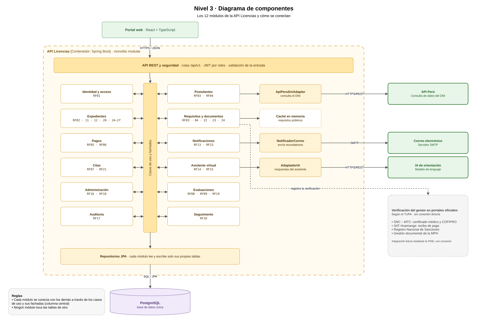

# Nivel 3 · Diagrama de componentes

> **Proyecto:** Sistema de Licencias de Conducir Clase B · **Contenedor detallado:** API Licencias  
> **Modelo:** C4 · Nivel 3 de 4 · **Versión:** 2.0

---

## 1. Objetivo

Abrir el contenedor **API Licencias** del nivel 2 y mostrar sus **componentes**: los módulos del monolito modular, la responsabilidad de cada uno y cómo se conectan entre sí, con la base de datos y con los servicios externos.

| Aspecto | Descripción |
|---|---|
| Pregunta que responde | ¿Cómo se divide el backend por dentro y qué hace cada parte? |
| Audiencia | Arquitectos y desarrolladores |
| Qué es un componente | Un grupo de funcionalidades con una responsabilidad clara, accesible mediante una interfaz. En este proyecto, cada **módulo** del monolito es un componente |
| Nivel anterior | `Nivel2-DiagramadeContenedores.md` |
| Siguiente nivel | `Nivel4-DiagramadeCodigo.md` |

---

## 2. Diagrama

> Archivo editable: `img/fuentes/nivel3-componentes.drawio`

## 3. Cómo se lee el diagrama

1. El **portal web** llama a la **API REST y seguridad**, que valida el JWT y el rol.
2. La API pasa la solicitud a la columna **casos de uso y fachadas**.
3. Los **12 módulos** se conectan con esa columna mediante flechas dobles: así se comunican entre ellos, siempre a través de sus fachadas.
4. Tres módulos usan un **adaptador** en su misma fila, que los conecta con un servicio externo real.
5. La columna central baja a los **repositorios JPA**, que leen y escriben en **PostgreSQL**.

---

## 4. Componentes

| Componente | Responsabilidad | Funcionalidades principales | Requisitos | Paquete en el código |
|---|---|---|---|---|
| **API REST y seguridad** | Punto de entrada HTTP | Rutas `/api/v1`, autenticación JWT, validación de la entrada, manejo de errores | RF01 | `pe.licencias.api` |
| **Identidad y acceso** | Cuentas y permisos | Registro, inicio de sesión y roles | RF01 | `pe.licencias.identidad` |
| **Postulantes** | Datos del postulante | Datos personales y validación del DNI con API Perú | RF03, RF04 | `pe.licencias.postulantes` |
| **Expedientes** | Ciclo del trámite | Emisión, revalidación y duplicado, número de trámite, etapas, validación, emisión y verificación de sanciones | RF02, RF11, RF12, RF20, RF24–RF27 | `pe.licencias.expedientes` |
| **Requisitos y documentos** | Documentación del expediente | Requisitos según el TUPA, carga y revisión de documentos, vigencia del certificado y verificación en el SNC | RF03, RF04, RF22, RF23, RF24 | `pe.licencias.documentos` |
| **Pagos** | Derecho de trámite | Registro del recibo del SAT y su verificación | RF05, RF06 | `pe.licencias.pagos` |
| **Citas** | Agenda de exámenes | Días de examen, cupos, elección de la cita y reprogramación | RF07, RF21 | `pe.licencias.citas` |
| **Evaluaciones** | Resultados de los exámenes | Conocimientos y manejo, máximo 3 intentos, corrección antes de validar y bloqueo después | RF08, RF09, RF19 | `pe.licencias.evaluaciones` |
| **Seguimiento** | Avance del trámite | Estado, historial, pendientes y plazo legal | RF10 | `pe.licencias.seguimiento` |
| **Notificaciones** | Comunicación con los usuarios | Avisos internos y recordatorios por correo | RF13, RF23 | `pe.licencias.notificaciones` |
| **Asistente virtual** | Orientación al postulante | Respuestas con contenido aprobado y derivación al gestor | RF14, RF15 | `pe.licencias.asistente` |
| **Administración** | Configuración del sistema | Usuarios, requisitos, días de examen, cupos, contenidos y reportes | RF16, RF18 | `pe.licencias.administracion` |
| **Auditoría** | Trazabilidad | Registro de usuario, fecha, acción y valores modificados | RF17 | `pe.licencias.auditoria` |

---

## 5. Adaptadores y servicios externos

| Módulo | Adaptador | Servicio externo | Protocolo |
|---|---|---|---|
| Postulantes | `ApiPeruDniAdapter` | API Perú | HTTPS/REST |
| Asistente virtual | `AdaptadorIA` | IA de orientación | HTTPS/REST |
| Notificaciones | `NotificadorCorreo` | Correo electrónico | SMTP |
| Requisitos y documentos | Caché en memoria | — (información pública) | En memoria |
| Requisitos y documentos | Registro de la verificación del gestor | SNC, SAT y Registro Nacional de Sanciones (portales oficiales) | Sin conexión directa |

---

## 6. Relaciones principales entre módulos

Todas las relaciones pasan por la columna de casos de uso y fachadas:

| Origen | Destino | Descripción |
|---|---|---|
| Pagos | Expedientes | Informa que el pago fue verificado |
| Citas | Evaluaciones | Crea el examen al confirmar la cita |
| Evaluaciones | Expedientes | Solicita avanzar a la siguiente etapa cuando el resultado se valida (RF20) |
| Seguimiento | Expedientes | Consulta el estado y el historial |
| Expedientes, Evaluaciones y Seguimiento | Notificaciones | Publican el cambio de estado (evento) |
| Todos los módulos | Auditoría | Registran sus operaciones importantes (evento) |

---

## 7. Reglas del monolito modular

| # | Regla | Motivo |
|---|---|---|
| 1 | Todos los componentes se despliegan juntos en el contenedor API Licencias | Es un monolito: un solo proceso y un solo despliegue (ADR-001) |
| 2 | Un módulo usa a otro solo a través de su fachada | Evita que un cambio interno en un módulo rompa a los demás (DA05) |
| 3 | Un módulo no lee ni escribe las tablas de otro módulo | Mantiene la independencia de los datos de cada módulo |
| 4 | Cada servicio externo se integra en un único módulo mediante un adaptador | La integración queda en un solo lugar (DA08) |
| 5 | Cada módulo se organiza por dentro con Clean Architecture | Las reglas del trámite no dependen de la tecnología (ADR-002, ver nivel 4) |
