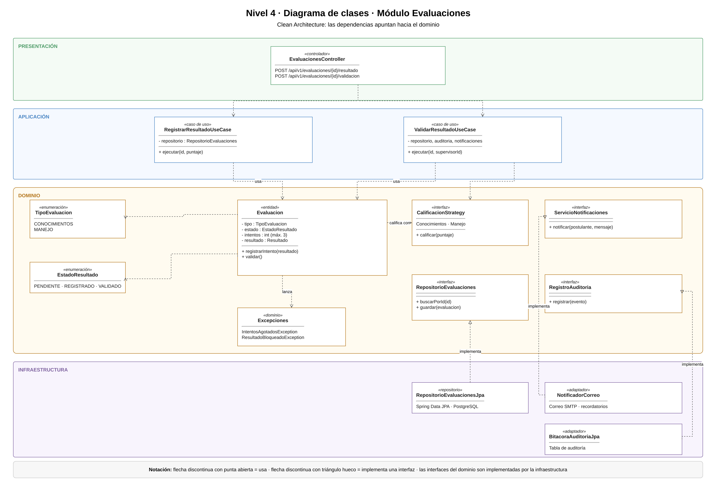
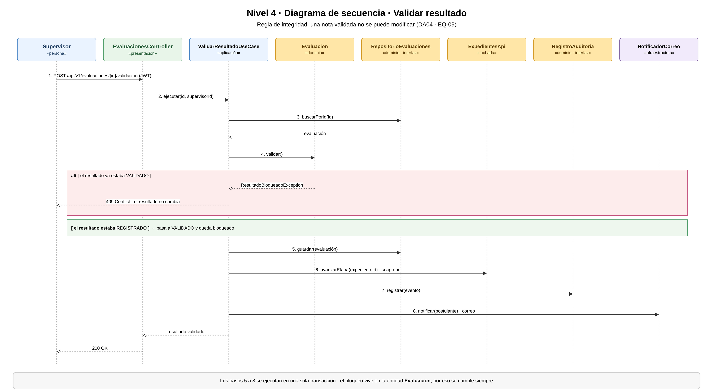

# Nivel 4 · Diagrama de código

> **Proyecto:** Sistema de Licencias de Conducir Clase B · **Módulo detallado:** Evaluaciones  
> **Modelo:** C4 · Nivel 4 de 4 · **Notación:** UML · **Versión:** 2.0

---

## 1. Objetivo

Mostrar **cómo está organizado el código** de un componente del nivel 3: sus clases, interfaces y la forma en que colaboran. Se detalla el módulo **Evaluaciones**, que contiene las reglas más críticas del trámite: el **máximo de 3 intentos** por examen y el **bloqueo de un resultado validado**.

| Aspecto | Descripción |
|---|---|
| Pregunta que responde | ¿Cómo se implementa por dentro un componente? |
| Audiencia | Desarrolladores |
| Componente detallado | Evaluaciones (nivel 3) |
| Requisitos cubiertos | RF08, RF09, RF13, RF17, RF19, RF20 |
| Driver principal | DA04 · Integridad de los resultados y del trámite |
| Nivel anterior | `Nivel3-Diagrama-de-Componentes.md` |

---

## 2. Diagrama de clases

> Archivo editable: `img/fuentes/nivel4-clases.drawio`

### 2.1 Capas de Clean Architecture

| Capa | Contiene | Regla |
|---|---|---|
| **Presentación** | Controlador REST | Traduce HTTP a llamadas del caso de uso y viceversa |
| **Aplicación** | Casos de uso | Coordina los pasos del proceso; no conoce la tecnología |
| **Dominio** | Entidad, enumeraciones, excepciones, estrategia e interfaces | Contiene las reglas del trámite; no importa nada de las otras capas |
| **Infraestructura** | Repositorio JPA y adaptadores | Implementa las interfaces del dominio con una tecnología concreta |

> **Regla de dependencia:** las dependencias del código apuntan hacia el dominio. Las clases de infraestructura implementan interfaces del dominio (triángulo hueco); el dominio nunca conoce a la infraestructura.

### 2.2 Clases del módulo Evaluaciones

| Clase | Tipo | Capa | Responsabilidad |
|---|---|---|---|
| `EvaluacionesController` | Controlador | Presentación | Recibe `/api/v1/evaluaciones/{id}/resultado` y `/validacion`; devuelve 200 o 409 |
| `RegistrarResultadoUseCase` | Caso de uso | Aplicación | Registra el resultado de un intento usando la estrategia de calificación del examen |
| `ValidarResultadoUseCase` | Caso de uso | Aplicación | Valida y bloquea el resultado, avanza la etapa, audita y notifica |
| `Evaluacion` | Entidad | Dominio | Controla los intentos (máximo 3), los estados y la regla de bloqueo |
| `TipoEvaluacion` | Enumeración | Dominio | CONOCIMIENTOS, MANEJO |
| `EstadoResultado` | Enumeración | Dominio | PENDIENTE, REGISTRADO, VALIDADO |
| `IntentosAgotadosException` | Excepción | Dominio | Indica que el postulante ya usó sus 3 intentos |
| `ResultadoBloqueadoException` | Excepción | Dominio | Indica que se intentó modificar un resultado validado |
| `CalificacionStrategy` | Interfaz (Strategy) | Dominio | Contrato para calificar según el examen: conocimientos o manejo |
| `RepositorioEvaluaciones` | Interfaz | Dominio | Contrato para guardar y buscar evaluaciones |
| `ServicioNotificaciones` | Interfaz | Dominio | Contrato para avisar al postulante |
| `RegistroAuditoria` | Interfaz | Dominio | Contrato para registrar operaciones |
| `RepositorioEvaluacionesJpa` | Repositorio | Infraestructura | Implementa `RepositorioEvaluaciones` con Spring Data JPA y PostgreSQL |
| `NotificadorCorreo` | Adaptador | Infraestructura | Implementa `ServicioNotificaciones` enviando correos (SMTP) |
| `BitacoraAuditoriaJpa` | Adaptador | Infraestructura | Implementa `RegistroAuditoria` con la tabla de auditoría |

---

## 3. Diagrama de secuencia: validar resultado

> Archivo editable: `img/fuentes/nivel4-secuencia.drawio`

| Paso | Origen → destino | Mensaje | Requisito |
|---|---|---|---|
| 1 | Supervisor → `EvaluacionesController` | `POST /api/v1/evaluaciones/{id}/validacion` con JWT | RF01 |
| 2 | Controlador → `ValidarResultadoUseCase` | `ejecutar(id, supervisorId)` | RF09 |
| 3 | Caso de uso → `RepositorioEvaluaciones` | `buscarPorId(id)` | — |
| 4 | Caso de uso → `Evaluacion` | `validar()` | RF09, DA04 |
| alt | Si ya estaba VALIDADO | `ResultadoBloqueadoException` → **409 Conflict** | EQ-09 |
| 5 | Caso de uso → `RepositorioEvaluaciones` | `guardar(evaluación)` | — |
| 6 | Caso de uso → `ExpedientesApi` | `avanzarEtapa(expedienteId)` si fue aprobada | RF20 |
| 7 | Caso de uso → `RegistroAuditoria` | `registrar(evento)` | RF17 |
| 8 | Caso de uso → `NotificadorCorreo` | `notificar(postulante)` por correo | RF13 |
| — | Controlador → Supervisor | **200 OK** | — |

---

## 4. Decisiones reflejadas en el código

| Decisión | Motivo |
|---|---|
| Las reglas de intentos y de bloqueo están en la entidad `Evaluacion` | Se cumplen siempre, venga la petición de la API, de una prueba o de otro módulo (DA04) |
| Los pasos 5 a 8 se ejecutan en una sola transacción | Evita que el resultado quede validado sin auditoría o sin avanzar la etapa |
| Evaluaciones usa a Expedientes mediante `ExpedientesApi` | Respeta la regla del monolito modular: ningún módulo accede a las tablas de otro (ADR-001) |
| La calificación usa el patrón Strategy | Conocimientos y manejo se califican distinto y los mínimos son configurables (RF16) |
| La notificación usa el adaptador `NotificadorCorreo` | El recordatorio llega aunque el postulante no ingrese al sistema (ADR-013) |
| El certificado médico no se evalúa en este módulo | Lo emite una clínica autorizada y se verifica en el SNC (módulo Requisitos y documentos) |
