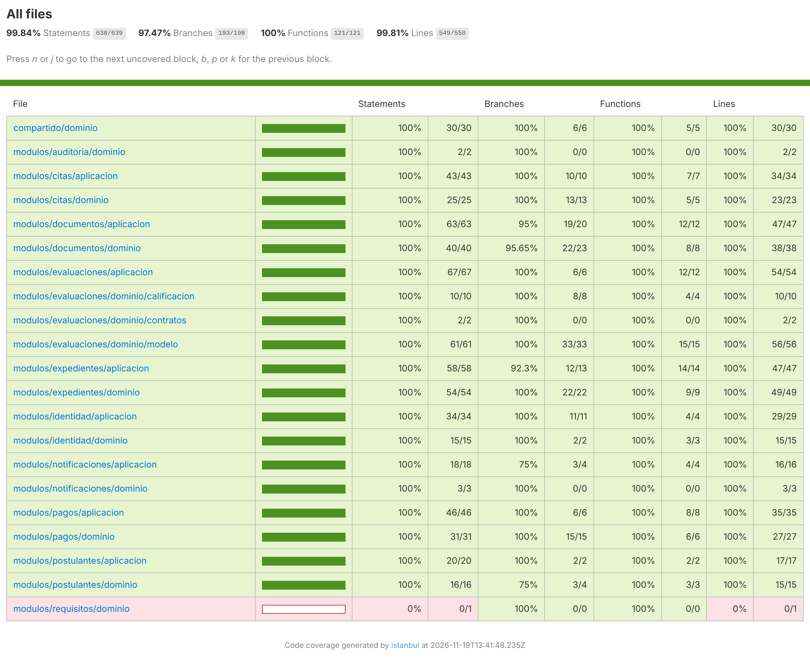
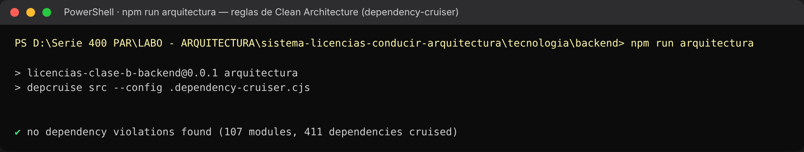

# Validación de los atributos de calidad · Sprint 2

Resultados de las pruebas basadas en los escenarios de `08-escenarios-atributos-calidad.md`. Cada fila indica la herramienta, la medida comprometida y el resultado obtenido.

> **Primera medición (19/11/2026):** entorno de desarrollo con 2 núcleos, Node.js 22 y PostgreSQL 16. La medición final se repite en la laptop del entorno de prueba y se guarda en esta carpeta.

## Resumen

| Escenario | Herramienta | Medida comprometida | Resultado | Estado |
|---|---|---|---|---|
| EQ-01 Seguridad | Jest + Supertest | 100 % de accesos sin permiso con 401/403 | 12 de 12 casos (2 sin token, 10 de la matriz rol × operación) | Cumple |
| EQ-02 Privacidad | Jest + Supertest | 20 de 20 accesos a expedientes ajenos con 403 | 20 de 20 (10 al expediente, 10 a sus documentos) y archivo sin token con 401 | Cumple |
| EQ-03 Rendimiento | k6 | p95 ≤ 3 s y errores < 1 % con 2,000 usuarios | p95 = 13.7 ms, 0 % de errores, 107,217 peticiones | Cumple |
| EQ-03 Caché | k6 (200 usuarios, 30 s) | Con caché, al menos 50 % más rápido | p95 de 167.6 ms a 81.7 ms (51 % menos); de 1,695 a 4,366 peticiones/s | Cumple |
| EQ-06 Mantenibilidad | dependency-cruiser y Jest | Reglas al 100 %; cobertura ≥ 80 % | 0 violaciones en 107 módulos; cobertura de líneas 99.8 % | Cumple |
| EQ-07 Trazabilidad | Jest + Supertest | 8 de 8 operaciones auditadas | 8 de 8, con usuario, fecha, valor anterior y nuevo | Cumple |
| EQ-09 Integridad | Jest + Supertest | 100 % de modificaciones a un validado con 409 | Corrección y segunda validación con 409; el resultado no cambia | Cumple |
| EQ-04 Disponibilidad | Terminus, UptimeRobot, pg_dump | 99 % en horario; restauración ≤ 30 min | `/api/health` listo; falta el monitoreo de 2 semanas | Sprint 3 (con el despliegue) |
| EQ-05 Usabilidad | Prueba con 5 usuarios y SUS | 4 de 5 sin ayuda; SUS ≥ 68 | Se realiza sobre el frontend conectado | Pendiente |
| EQ-08 IA | promptfoo | ≥ 90 % correctas; 100 % derivadas | El asistente se implementa en el sprint 3 | Sprint 3 |

## Evidencias guardadas (laptop del entorno de prueba)

| Archivo | Contenido |
|---|---|
| [`evidencias/01-pruebas-unitarias-jest.txt`](evidencias/01-pruebas-unitarias-jest.txt) | 54 pruebas unitarias aprobadas y la tabla de cobertura por archivo |
| [`evidencias/02-pruebas-api-jest-supertest.txt`](evidencias/02-pruebas-api-jest-supertest.txt) | 23 pruebas de la API con PostgreSQL: flujo completo, 401/403, 409 y auditoría |
| [`evidencias/03-reglas-arquitectura.txt`](evidencias/03-reglas-arquitectura.txt) | dependency-cruiser: 0 violaciones en 107 módulos |
| [`evidencias/cobertura-jest/index.html`](evidencias/cobertura-jest/index.html) | Reporte de cobertura navegable (abrir en el navegador) |

### Capturas

**Pruebas unitarias con cobertura (Jest)**

**Reporte de cobertura**

**Pruebas de la API con PostgreSQL (Jest + Supertest)**

**Reglas de arquitectura (dependency-cruiser)**

## Pruebas automatizadas

| Tipo | Cantidad | Comando |
|---|---|---|
| Unitarias (dominio y casos de uso) | 54 | `npm run test:cov` |
| De API con PostgreSQL real | 23 | `npm run test:e2e` |
| Reglas de arquitectura | 4 reglas | `npm run arquitectura` |

**Cobertura de Jest** (dominio y aplicación): sentencias 99.8 %, ramas 97.5 %, funciones 100 %, líneas 99.8 %. El umbral mínimo configurado es 80 %: si baja, GitHub Actions falla.

## Lo que encontró la regla de arquitectura

La primera ejecución de dependency-cruiser detectó que el caso de uso de Notificaciones importaba directamente una entidad de TypeORM, lo que rompe Clean Architecture. Se corrigió con el contrato `RepositorioAvisos` en el dominio y su implementación en infraestructura. Desde entonces la regla corre en cada push.

## Carga progresiva con k6 (EQ-03)

Script: `tecnologia/pruebas-calidad/k6/carga-progresiva.js` (subida a 500, 1,000 y 2,000 usuarios, con 1 a 3 s de pausa entre peticiones). Esta primera medición usó etapas cortas (2 min 45 s en total); el script completo dura 9 minutos y es el que se usa en la medición final.

| Métrica | Valor |
|---|---|
| Usuarios virtuales máximos | 2,000 |
| Peticiones | 107,217 |
| Errores | 0 % |
| Tiempo promedio | 4.1 ms |
| p95 | 13.7 ms |
| Máximo | 180.8 ms |

Las consultas probadas son requisitos (con caché), detalle del expediente y bandeja del gestor.
