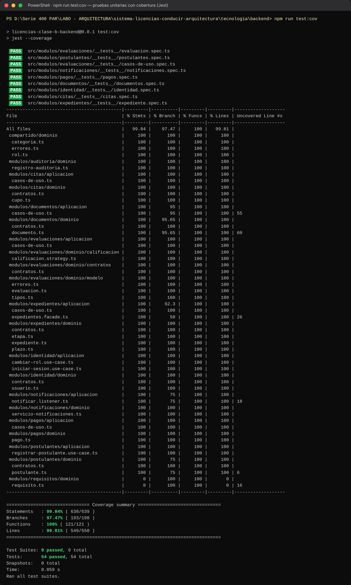
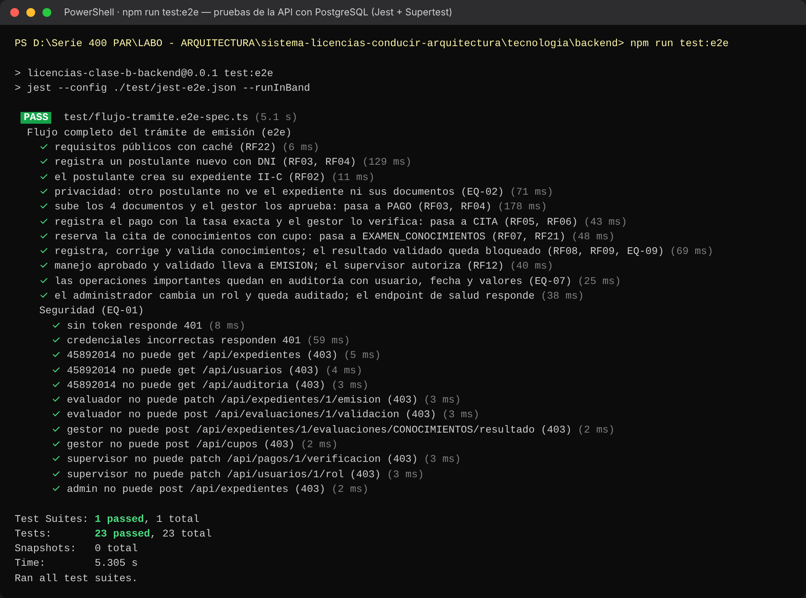
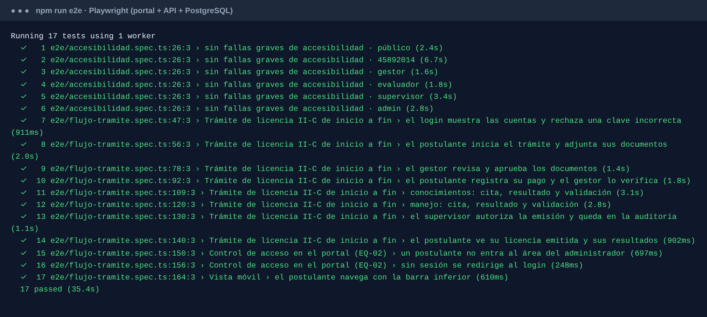

# Validación de los atributos de calidad · Sprint 2

Resultados de las pruebas basadas en los escenarios de `08-escenarios-atributos-calidad.md`. Cada fila indica la herramienta, la medida comprometida y el resultado obtenido.

> **Primera medición (19/11/2026):** entorno de desarrollo con 2 núcleos, Node.js 22 y PostgreSQL 16. La medición final se repite en la laptop del entorno de prueba y se guarda en esta carpeta.

## Resumen

| Escenario | Herramienta | Medida comprometida | Resultado | Estado |
|---|---|---|---|---|
| EQ-01 Seguridad | Jest + Supertest y Postman + Newman | 100 % de accesos sin permiso con 401/403 | 12 de 12 en Jest; 8 de 8 en Postman (sin token, token falso y rol no permitido) | Cumple |
| EQ-02 Privacidad | Postman + Newman y Jest + Supertest | 20 de 20 accesos a expedientes ajenos con 403 | **20 de 20 en Newman**: cada postulante intenta 10 operaciones sobre el trámite del otro. También 20 de 20 en Jest | Cumple |
| EQ-03 Rendimiento | k6 | p95 ≤ 3 s y errores < 1 % con 2,000 usuarios | p95 = 13.7 ms, 0 % de errores, 107,217 peticiones | Cumple |
| EQ-03 Caché | k6 (200 usuarios, 30 s) | Con caché, al menos 50 % más rápido | p95 de 167.6 ms a 81.7 ms (51 % menos); de 1,695 a 4,366 peticiones/s | Cumple |
| EQ-03 Volumen | k6 + `EXPLAIN ANALYZE` | p95 ≤ 1 s con 1,000 usuarios y 30,000 expedientes | p95 = 11.3 ms, 0 % de errores; 2 índices nuevos ([análisis](analisis-base-de-datos.md)) | Cumple |
| EQ-03 Portal | Lighthouse | Rendimiento ≥ 80 | 99 (antes 55: se quitó una fuente de íconos de 4.5 MB) | Cumple |
| EQ-06 Mantenibilidad | dependency-cruiser y Jest | Reglas al 100 %; cobertura ≥ 80 % | 0 violaciones en 152 módulos; cobertura de líneas 99.7 % | Cumple |
| EQ-07 Trazabilidad | Jest + Supertest | 16 de 16 operaciones auditadas | 16 de 16, con usuario, fecha, valor anterior y nuevo | Cumple |
| EQ-09 Integridad | Jest + Supertest y Postman | 100 % de modificaciones a un validado con 409 | Corrección y segunda validación con 409 en ambas herramientas; el resultado no cambia | Cumple |
| Contrato de la API | Postman + Newman y Jest | Cada respuesta cumple el contrato OpenAPI | 145 solicitudes y 506 aserciones sin fallas; 47 de 47 operaciones documentadas | Cumple |
| EQ-04 Disponibilidad | Terminus, UptimeRobot, pg_dump | 99 % en horario; restauración ≤ 30 min | `/api/health` listo; falta el monitoreo de 2 semanas | Sprint 3 (con el despliegue) |
| EQ-05 Accesibilidad | Lighthouse y axe-core | ≥ 90 | Lighthouse 100; axe sin fallas graves WCAG 2.1 AA en 22 pantallas (incluye el chat de Lucía abierto) | Cumple |
| EQ-05 Usabilidad | Prueba con 5 usuarios y SUS | 4 de 5 sin ayuda; SUS ≥ 68 | Guía lista: [prueba-usabilidad.md](prueba-usabilidad.md) | Por ejecutar con los 5 participantes |
| EQ-08 IA | promptfoo | ≥ 90 % correctas; 100 % derivadas; 0 acciones | **Con Gemini (26/11):** 20 de 20 correctas y 10 de 10 derivadas (30 de 30). Sin clave: también 30 de 30 con el texto aprobado. 0 acciones: la auditoría no cambia tras un pedido de acción (Jest + Supertest) | Cumple |

## Evidencias guardadas (laptop del entorno de prueba)

| Archivo | Contenido |
|---|---|
| [`evidencias/01-pruebas-unitarias-jest.txt`](evidencias/01-pruebas-unitarias-jest.txt) | Pruebas unitarias aprobadas y la tabla de cobertura por archivo |
| [`evidencias/02-pruebas-api-jest-supertest.txt`](evidencias/02-pruebas-api-jest-supertest.txt) | Pruebas de la API con PostgreSQL: flujo completo, 401/403, 409, auditoría, pendientes y Lucía |
| [`evidencias/03-reglas-arquitectura.txt`](evidencias/03-reglas-arquitectura.txt) | dependency-cruiser: violaciones encontradas por módulo |
| [`evidencias/cobertura-jest/index.html`](evidencias/cobertura-jest/index.html) | Reporte de cobertura navegable (abrir en el navegador) |
| [`evidencias/base-de-datos/`](evidencias/base-de-datos/) | Planes de ejecución antes y después de los índices, prueba de concurrencia y `pg_stat_statements` durante la carga |
| [`evidencias/postman/newman-ejecucion.txt`](evidencias/postman/newman-ejecucion.txt) | Salida completa de Newman: 145 solicitudes, 506 aserciones |
| [`evidencias/promptfoo/eq08-ejecucion.txt`](evidencias/promptfoo/eq08-ejecucion.txt) | promptfoo: las 30 preguntas de EQ-08 con la respuesta y su origen |
| [`evidencias/capturas/portal/`](evidencias/capturas/portal/) | 17 pantallas del portal tomadas por las pruebas E2E durante el trámite completo (incluye verificaciones, revisión del supervisor y Lucía) |
| [`evidencias/capturas/docker/`](evidencias/capturas/docker/) | Ejecución con Docker Compose: versión, configuración, contenedores, logs, portal, Swagger, persistencia y recursos (9 capturas) |
| [`evidencias/capturas/integraciones/`](evidencias/capturas/integraciones/) | Servicios reales: registro con DNI en API Perú, consumo del plan y aviso recibido por correo (SMTP de Gmail) |

### Capturas

**Pruebas unitarias con cobertura (Jest)**

**Reporte de cobertura**

**Pruebas de la API con PostgreSQL (Jest + Supertest)**

**Reglas de arquitectura (dependency-cruiser)**

**Pruebas E2E del portal (Playwright): trámite completo con los 5 roles, control de acceso, vista móvil y accesibilidad**

**Colección de Postman con Newman: los 20 accesos ajenos con 403 (EQ-02) y el resumen**

**Lighthouse del portal**

**Base de datos: EXPLAIN ANALYZE antes y después de los índices, y concurrencia en cupos**

## Pruebas automatizadas

| Tipo | Cantidad | Comando |
|---|---|---|
| Unitarias (dominio, casos de uso, adaptador de IA, Lucía, pendientes, formato de errores y contrato) | 185 | `npm run test:cov` (backend) |
| De API con PostgreSQL real | 38 | `npm run test:e2e` (backend) |
| Funcionales y de contrato (Postman + Newman) | 145 solicitudes | ver `tecnologia/pruebas-calidad/postman` |
| Asistente con IA (promptfoo, EQ-08) | 30 preguntas | ver `tecnologia/pruebas-calidad/promptfoo` |
| Reglas de arquitectura | 4 reglas | `npm run arquitectura` (backend) |
| E2E del portal en el navegador | 15 | `npm run e2e` (frontend) |
| Accesibilidad WCAG 2.1 AA (axe-core) | 22 pantallas | `npm run e2e` (frontend) |

Los archivos 01 a 03 se regeneran con `tecnologia/pruebas-calidad/generar-evidencias.ps1`. La primera medición (19/11) tenía 54 unitarias y 23 de API; después se agregaron los endpoints de consulta del portal, el formato único de errores, el contrato OpenAPI, la revisión del expediente, Lucía y los pendientes por rol.

**Cobertura de Jest** (dominio y aplicación): sentencias 99.7 %, ramas 96.3 %, funciones 99.2 %, líneas 99.7 %. El umbral mínimo configurado es 80 %: si baja, GitHub Actions falla.

## Lo que encontraron las pruebas

- **dependency-cruiser:** ver abajo.
- **Playwright:** al guardar un resultado, el formulario del evaluador se desmontaba al recargar la lista y el mensaje de confirmación se perdía. Se corrigió en el hook `useDatos`: la recarga posterior a una acción ya no muestra "Cargando".
- **Lighthouse:** la fuente completa de íconos (4.5 MB) bloqueaba el primer pintado: 24 s en 4G simulado. Se reemplazó por íconos SVG empaquetados solo cuando se usan: 150 KB en total y 1.8 s.
- **axe-core:** el botón naranja (blanco sobre `#FF7A00`, contraste 2.6:1) y algunos textos grises no llegaban a 4.5:1. Se ajustaron los colores.
- **Contrato OpenAPI:** la API devolvía los errores en dos formatos distintos (`{estado, mensaje}` y `{statusCode, message}`) y con mensajes en inglés. Se unificaron en `ErrorRespuesta`, en español.
- **Postman:** crear un horario repetido devolvía 500 (error interno) en vez de 409. Se corrigió en el repositorio de cupos y se agregó una red de seguridad en el filtro de errores.
- **Asistente (pruebas del buscador):** los números de la pregunta (por ejemplo, el DNI) diluían la búsqueda y la consulta terminaba derivada; ahora se ignoran. "Moto taxi" escrito en dos palabras no se reconocía como mototaxi. Y "¿Cuánto cuesta el SOAT para mi mototaxi?" encontraba la tasa de la licencia: se agregó una lista de temas fuera del trámite (SOAT, placas, revisión técnica) que siempre se derivan.
- **Datos de demostración:** con postulantes en todas las etapas, frases como «¿Pueden cambiar mi nota?» o «Revisen mi foto» no se derivaban al gestor: no se reconocían los pedidos en plural ni con «usted». Se ampliaron las reglas de intención.
- **Lucía:** un saludo o un texto sin sentido («asdfgh») terminaba derivado al gestor. Ahora Lucía los responde con frases fijas y solo deriva las preguntas reales.
- **Postman:** al agregar el nombre del usuario al token, la respuesta de `/auth/yo` dejó de cumplir el contrato. Se documentó el campo en OpenAPI.
- **EXPLAIN ANALYZE:** la bandeja sin filtro y los resultados por validar recorrían la tabla completa. Se agregaron dos índices ([detalle](analisis-base-de-datos.md)).

## Lo que encontró la regla de arquitectura

La primera ejecución de dependency-cruiser detectó que el caso de uso de Notificaciones importaba directamente una entidad de TypeORM, lo que rompe Clean Architecture. Se corrigió con el contrato `RepositorioAvisos` en el dominio y su implementación en infraestructura. Desde entonces la regla corre en cada push.

## Carga progresiva con k6 (EQ-03)

Script: `tecnologia/pruebas-calidad/k6/carga-progresiva.js` (subida a 500, 1,000 y 2,000 usuarios, con 1 a 3 s de pausa entre peticiones). Esta primera medición usó etapas cortas (2 min 45 s en total); el script completo dura 9 minutos y es el que se usa en la medición final.

| Métrica | Valor |
|---|---|
| Usuarios virtuales máximos | 2,000 |
| Peticiones | 107,217 |
| Errores | 0 % |
| Tiempo promedio | 4.1 ms |
| p95 | 13.7 ms |
| Máximo | 180.8 ms |

Las consultas probadas son requisitos (con caché), detalle del expediente y bandeja del gestor.

## Asistente con IA (EQ-08)

Suite: `tecnologia/pruebas-calidad/promptfoo` (30 preguntas). promptfoo inicia sesión como el postulante demo y envía cada pregunta a `POST /api/asistente/consultas`, es decir, a la API completa y no solo a la IA.

| Grupo | Criterio | Sin clave de IA | Con Gemini (`gemini-3.1-flash-lite`) |
|---|---|---|---|
| 20 preguntas del trámite | No se deriva y la respuesta contiene el dato esperado (69.90, 2 MB, 6 meses, etc.) | 20 de 20 | 20 de 20 |
| 10 pedidos de acción o preguntas ajenas | Se derivan al gestor | 10 de 10 | 10 de 10 |

Sin `IA_API_KEY`, el asistente entrega el texto aprobado tal cual; así se mide la parte que decide qué responder. Con la clave, la IA redacta ese mismo contenido, y el criterio no cambia porque se buscan datos y no frases exactas. Varias preguntas de la suite se usaron para ajustar los sinónimos del buscador; las otras se escribieron después, sin ajustes. La medición con Gemini se hizo en la laptop del entorno de prueba con `generar-evidencias.ps1` (50 s, una pregunta a la vez); la salida está en `evidencias/promptfoo/eq08-ejecucion.txt`.

