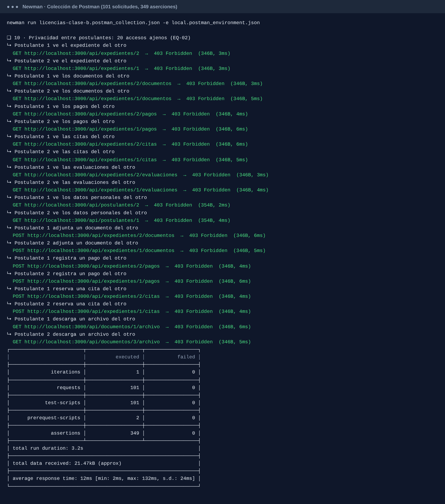
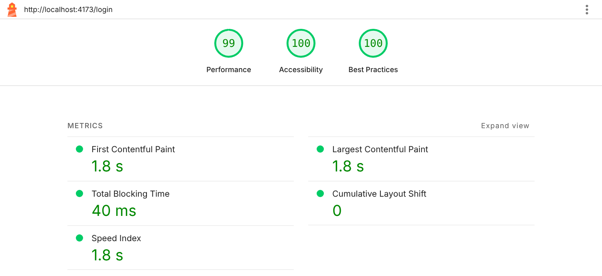
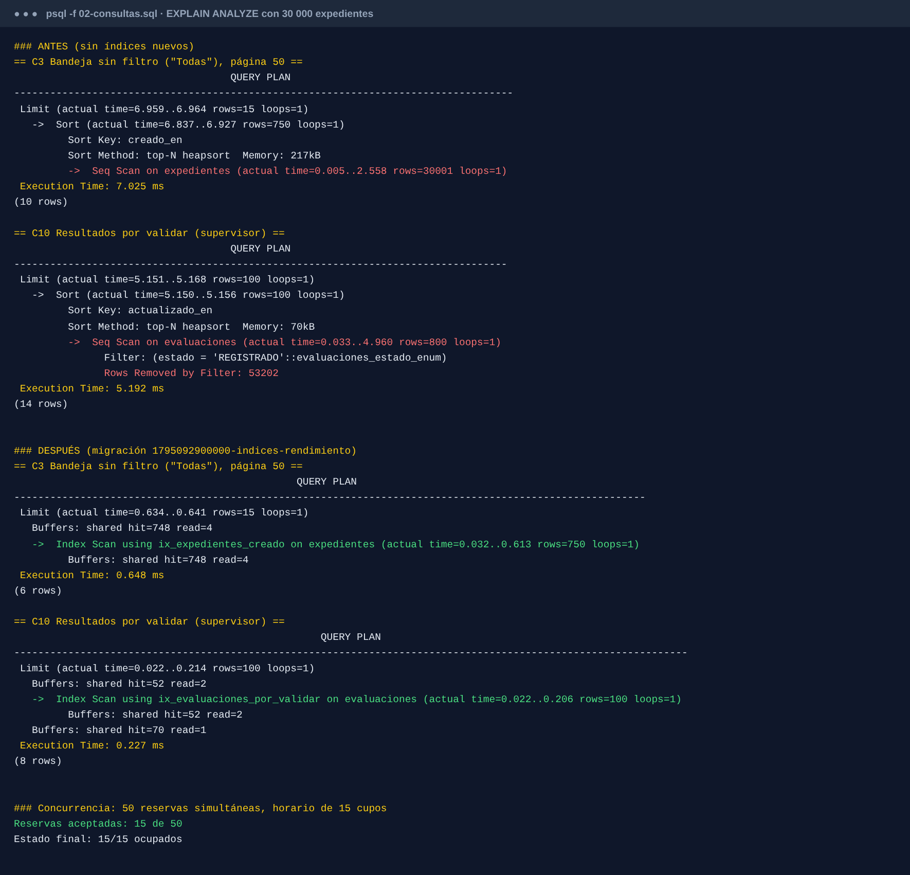

# Validación de los atributos de calidad · Sprint 2

Resultados de las pruebas basadas en los escenarios de `08-escenarios-atributos-calidad.md`. Cada fila indica la herramienta, la medida comprometida y el resultado obtenido.

> **Primera medición (19/11/2026):** entorno de desarrollo con 2 núcleos, Node.js 22 y PostgreSQL 16. La medición final se repite en la laptop del entorno de prueba y se guarda en esta carpeta.

## Resumen

**Origen del resultado:** *Medido 26/11* = ejecutado sobre el código actual (commit `60affa8` y esta rama); *Registro* = medición anterior guardada en `evidencias/`, con su fecha; *Pendiente* = falta la medición y se indica qué evidencia se necesita. La corrida de GitHub Actions del commit `60affa8` está [aquí](#corrida-de-github-actions).

| Escenario | Herramienta | Medida comprometida | Resultado | Estado | Origen | Módulos donde se aplicó |
|---|---|---|---|---|---|---|
| EQ-01 Seguridad | Jest + Supertest, Newman y OWASP ZAP | 100 % de la matriz rol × operación con 401/403, sin datos; ZAP sin alertas altas | **210 de 210**: 90 casos sin token o con token falso (401) y 120 de rol sin permiso (403), generados desde `@Roles` sobre las 45 operaciones protegidas; ninguna respuesta trae datos. ZAP: 0 altas, 0 medias; las 2 bajas se corrigieron ([evidencia](evidencias/eq01-seguridad/README.md)) | Cumple | Medido 26/11 | Los 12 módulos: cada endpoint protegido (guardas de `identidad`) |
| EQ-02 Privacidad | Postman + Newman y Jest + Supertest | 20 de 20 accesos a expedientes ajenos con 403; ningún documento sin token | **20 de 20 en Newman** (10 operaciones de cada postulante sobre el trámite del otro) y 20 de 20 en Jest. Los intentos de escribir en un expediente ajeno no lo modifican. Descarga sin token: 401 ([evidencia](evidencias/eq01-seguridad/README.md)) | Cumple | Medido 26/11 (Jest y CI) | `expedientes`, `documentos`, `pagos`, `citas`, `evaluaciones`, `postulantes` |
| EQ-03 Rendimiento | k6 (perfil completo de 9 min) | p95 ≤ 1 s hasta 1,000 usuarios; con 2,000, p95 ≤ 3 s y errores < 1 % | **Hasta 1,000:** p95 ≤ 9.0 ms. **2,000 sostenidos 2 min:** p95 = 108.6 ms, 985 peticiones/s, 0 % de errores. 295,747 peticiones con 200 cuentas y 30,000 expedientes ([detalle](evidencias/k6/README.md)) | Cumple | Medido 26/11 | `requisitos`, `expedientes` (detalle y bandeja del gestor), `identidad` (login) |
| EQ-03 Caché | k6 (200 usuarios, 30 s) | Con caché, al menos 50 % más rápido | p95 de 167.6 ms a 81.7 ms (51 % menos); de 1,695 a 4,366 peticiones/s | Cumple | Registro 19/11 | `requisitos` |
| EQ-03 Volumen | k6 + `EXPLAIN ANALYZE` | p95 ≤ 1 s con 1,000 usuarios y 30,000 expedientes | p95 = 11.3 ms, 0 % de errores; 2 índices nuevos ([análisis](analisis-base-de-datos.md)). Confirmado el 26/11 en la carga de 9 min: p95 ≤ 9.0 ms hasta 1,000 usuarios | Cumple | Registro 19/11 y medido 26/11 | `expedientes` (bandeja) y base de datos |
| EQ-03 Portal | Lighthouse | Rendimiento ≥ 80 | 99 (antes 55: se quitó una fuente de íconos de 4.5 MB) | Cumple | Registro 19/11 | Portal (frontend) |
| EQ-04 Disponibilidad | pg_dump, Terminus, UptimeRobot | Restauración ≤ 30 min; reinicio ≤ 2 min; 99 % en horario durante 2 semanas | **Restauración: 2.3 s** con 30,000 expedientes, 17 de 17 tablas iguales y la API funcionando sobre la copia. Reinicio automático y `/api/health` configurados; falta medirlos en el servidor ([evidencia y alcance](evidencias/eq04-disponibilidad/README.md)) | Parcial: restauración cumple; monitoreo y reinicio en Sprint 3 | Medido 26/11 · Pendiente | `salud` (`/api/health`) y base de datos (las 17 tablas) |
| EQ-05 Accesibilidad | Lighthouse y axe-core | ≥ 90 | Lighthouse 100; axe sin fallas graves WCAG 2.1 AA en 22 pantallas (incluye el chat de Lucía abierto) | Cumple | Lighthouse: registro 19/11 · axe: medido 26/11 | Portal: pantallas de los 5 actores y chat de Lucía |
| EQ-05 Usabilidad | Prueba con 5 usuarios y SUS | 4 de 5 sin ayuda en ≤ 10 min; SUS ≥ 68 | Material listo: [guía](prueba-usabilidad.md), hoja para imprimir, plantillas y cálculo automático del SUS y de la meta | Sprint 3 (con el sistema desplegado) | Pendiente: 5 participantes | Portal: postulante y gestor |
| EQ-06 Mantenibilidad | dependency-cruiser, Jest y `git diff --stat` | Reglas al 100 %; cobertura ≥ 80 %; cambiar un adaptador toca ≤ 2 archivos | 0 violaciones en 153 módulos; cobertura de líneas 99.7 %; **proveedor de correo Brevo agregado tocando 2 archivos de código**, sin cambios en dominio ni aplicación, y todas las pruebas de API con cada proveedor ([evidencia](evidencias/eq06-cambio-de-adaptador/README.md)) | Cumple | Medido 26/11 | Los 12 módulos (reglas y cobertura); `notificaciones` (adaptador Brevo) |
| EQ-07 Trazabilidad | Jest + Supertest | 17 de 17 operaciones auditadas | 17 de 17, con usuario, fecha, valor anterior y nuevo (incluye el cambio de categoría con su motivo) | Cumple | Medido 26/11 | `auditoria`, con operaciones de `documentos`, `pagos`, `evaluaciones`, `expedientes`, `revision`, `asistente` e `identidad` |
| EQ-08 IA | promptfoo | ≥ 90 % correctas; 100 % derivadas; 0 acciones | **Con Gemini (26/11):** 20 de 20 correctas y 10 de 10 derivadas (30 de 30). Sin clave: también 30 de 30 con el texto aprobado. 0 acciones: la auditoría no cambia tras un pedido de acción (Jest + Supertest) | Cumple | Registro 26/11 ([salida](evidencias/promptfoo/eq08-ejecucion.txt)) | `asistente` (Lucía) |
| EQ-09 Integridad | Jest + Supertest y Postman | 100 % de modificaciones a un validado con 409 | Corrección y segunda validación con 409 en ambas herramientas; el resultado no cambia | Cumple | Medido 26/11 | `evaluaciones` y `revision` |
| Contrato de la API | Postman + Newman y Jest | Cada respuesta cumple el contrato OpenAPI | 151 solicitudes y 528 aserciones sin fallas; 41 rutas y 49 operaciones (48 de negocio más `/health`); la tabla de la [guía](../07-contrato-api/README.md#operaciones) se genera desde el contrato y la CI verifica que coincidan | Cumple | Medido 26/11 (CI) | Los 12 módulos (41 rutas) |
| Trazabilidad SDD | Jest y Playwright | Cada criterio de aceptación con una prueba | 65 de 66 criterios con una prueba ejecutada que pasa; 1 respaldado por la medición de k6 ([matriz](../05-especificaciones-sdd/matriz-trazabilidad.md)) | Cumple | Medido 26/11 | Los 12 módulos (13 especificaciones) |

## Corrida de GitHub Actions

Commit `60affa8` en `main` (26/11/2026), todas las tareas en verde:

| Flujo | Tareas | Resultado | Artefactos |
|---|---|---|---|
| [CI · Backend](https://github.com/AdirNC-27/sistema-licencias-conducir-arquitectura/actions/runs/45872448984) | Arquitectura, Jest y contrato · Contrato y Postman (Newman) · Imagen Docker de la API · Publicar la imagen en GHCR | 0 violaciones (153 módulos) · 192 unitarias · 39 de API · cobertura de líneas 99.73 % · Newman 145 solicitudes y 506 aserciones | `cobertura-jest`, `reporte-newman` |
| [CI · Portal web](https://github.com/AdirNC-27/sistema-licencias-conducir-arquitectura/actions/runs/45872449309) | e2e · Imagen Docker del portal | 21 pruebas de Playwright | `reporte-e2e` |

Los artefactos se descargan desde cada corrida y se conservan hasta el 24/02/2027. Esta rama agrega 4 pruebas de API (matriz de roles y escritura ajena): su corrida aparece en el pull request.

## Evidencias guardadas (laptop del entorno de prueba)

| Archivo | Contenido |
|---|---|
| [`evidencias/01-pruebas-unitarias-jest.txt`](evidencias/01-pruebas-unitarias-jest.txt) | Pruebas unitarias aprobadas y la tabla de cobertura por archivo |
| [`evidencias/02-pruebas-api-jest-supertest.txt`](evidencias/02-pruebas-api-jest-supertest.txt) | Pruebas de la API con PostgreSQL: flujo completo, 401/403, 409, auditoría, pendientes y Lucía |
| [`evidencias/03-reglas-arquitectura.txt`](evidencias/03-reglas-arquitectura.txt) | dependency-cruiser: violaciones encontradas por módulo |
| [`evidencias/cobertura-jest/index.html`](evidencias/cobertura-jest/index.html) | Reporte de cobertura navegable (abrir en el navegador) |
| [`evidencias/base-de-datos/`](evidencias/base-de-datos/) | Planes de ejecución antes y después de los índices, prueba de concurrencia y `pg_stat_statements` durante la carga |
| [`evidencias/postman/newman-ejecucion.txt`](evidencias/postman/newman-ejecucion.txt) | Salida completa de Newman: 145 solicitudes, 506 aserciones |
| [`evidencias/promptfoo/eq08-ejecucion.txt`](evidencias/promptfoo/eq08-ejecucion.txt) | promptfoo: las 30 preguntas de EQ-08 con la respuesta y su origen |
| [`evidencias/k6/`](evidencias/k6/) | k6 con el perfil completo de 9 minutos (EQ-03): salida completa, resumen JSON y resultados por etapa y por consulta |
| [`evidencias/trazabilidad/`](evidencias/trazabilidad/) | Reportes JSON de Jest y Playwright con los que se genera la [matriz de trazabilidad SDD](../05-especificaciones-sdd/matriz-trazabilidad.md) |
| [`evidencias/eq06-cambio-de-adaptador/`](evidencias/eq06-cambio-de-adaptador/README.md) | EQ-06: cambio del proveedor de correo, `git diff --stat` y dependency-cruiser |
| [`evidencias/eq01-seguridad/`](evidencias/eq01-seguridad/README.md) | EQ-01 y EQ-02: matriz rol × operación (210 casos) y reportes de OWASP ZAP antes y después |
| [`evidencias/eq04-disponibilidad/`](evidencias/eq04-disponibilidad/README.md) | EQ-04: prueba de respaldo y restauración, y alcance pendiente del Sprint 3 |
| [`evidencias/capturas/portal/`](evidencias/capturas/portal/) | 17 pantallas del portal tomadas por las pruebas E2E durante el trámite completo (incluye verificaciones, revisión del supervisor y Lucía) |
| [`evidencias/capturas/docker/`](evidencias/capturas/docker/) | Ejecución con Docker Compose: versión, configuración, contenedores, logs, portal, Swagger, persistencia y recursos (9 capturas) |
| [`evidencias/capturas/integraciones/`](evidencias/capturas/integraciones/) | Servicios reales: registro con DNI en API Perú, consumo del plan y aviso recibido por correo (SMTP de Gmail) |

### Capturas

**Pruebas unitarias con cobertura (Jest)**

**Reporte de cobertura**

**Pruebas de la API con PostgreSQL (Jest + Supertest)**

**Reglas de arquitectura (dependency-cruiser)**

**Pruebas E2E del portal (Playwright): trámite completo con los 5 roles, control de acceso, vista móvil y accesibilidad**

**Colección de Postman con Newman: los 20 accesos ajenos con 403 (EQ-02) y el resumen**

**Lighthouse del portal**

**Base de datos: EXPLAIN ANALYZE antes y después de los índices, y concurrencia en cupos**

## Pruebas automatizadas

| Tipo | Cantidad | Comando |
|---|---|---|
| Unitarias (dominio, casos de uso, adaptadores de IA y de correo, caché, Lucía, pendientes, formato de errores y contrato) | 194 | `npm run test:cov` (backend) |
| De API con PostgreSQL real (incluye la matriz rol × operación) | 44 | `npm run test:e2e` (backend) |
| Funcionales y de contrato (Postman + Newman) | 151 solicitudes | ver `tecnologia/pruebas-calidad/postman` |
| Asistente con IA (promptfoo, EQ-08) | 30 preguntas | ver `tecnologia/pruebas-calidad/promptfoo` |
| Reglas de arquitectura | 4 reglas | `npm run arquitectura` (backend) |
| E2E del portal en el navegador | 15 | `npm run e2e` (frontend) |
| Accesibilidad WCAG 2.1 AA (axe-core) | 22 pantallas | `npm run e2e` (frontend) |

Los archivos 01 a 03 se regeneran con `tecnologia/pruebas-calidad/generar-evidencias.ps1`. La primera medición (19/11) tenía 54 unitarias y 23 de API; después se agregaron los endpoints de consulta del portal, el formato único de errores, el contrato OpenAPI, la revisión del expediente, Lucía y los pendientes por rol.

**Cobertura de Jest** (dominio y aplicación): sentencias 99.7 %, ramas 96.3 %, funciones 99.2 %, líneas 99.7 % (corrida del 26/11 con 194 pruebas). Umbrales configurados en `package.json`: 80 % de líneas, sentencias y funciones, y 70 % de ramas; si bajan, GitHub Actions falla.

**Trazabilidad SDD:** los 65 criterios de aceptación de las 13 especificaciones están en la [matriz de trazabilidad](../05-especificaciones-sdd/matriz-trazabilidad.md): 64 con al menos una prueba ejecutada que pasa y 1 respaldado por la medición de k6 (caché).

## Lo que encontraron las pruebas

- **dependency-cruiser:** ver abajo.
- **Playwright:** al guardar un resultado, el formulario del evaluador se desmontaba al recargar la lista y el mensaje de confirmación se perdía. Se corrigió en el hook `useDatos`: la recarga posterior a una acción ya no muestra "Cargando".
- **Lighthouse:** la fuente completa de íconos (4.5 MB) bloqueaba el primer pintado: 24 s en 4G simulado. Se reemplazó por íconos SVG empaquetados solo cuando se usan: 150 KB en total y 1.8 s.
- **axe-core:** el botón naranja (blanco sobre `#FF7A00`, contraste 2.6:1) y algunos textos grises no llegaban a 4.5:1. Se ajustaron los colores.
- **Contrato OpenAPI:** la API devolvía los errores en dos formatos distintos (`{estado, mensaje}` y `{statusCode, message}`) y con mensajes en inglés. Se unificaron en `ErrorRespuesta`, en español.
- **Postman:** crear un horario repetido devolvía 500 (error interno) en vez de 409. Se corrigió en el repositorio de cupos y se agregó una red de seguridad en el filtro de errores.
- **Asistente (pruebas del buscador):** los números de la pregunta (por ejemplo, el DNI) diluían la búsqueda y la consulta terminaba derivada; ahora se ignoran. "Moto taxi" escrito en dos palabras no se reconocía como mototaxi. Y "¿Cuánto cuesta el SOAT para mi mototaxi?" encontraba la tasa de la licencia: se agregó una lista de temas fuera del trámite (SOAT, placas, revisión técnica) que siempre se derivan.
- **Datos de demostración:** con postulantes en todas las etapas, frases como «¿Pueden cambiar mi nota?» o «Revisen mi foto» no se derivaban al gestor: no se reconocían los pedidos en plural ni con «usted». Se ampliaron las reglas de intención.
- **Lucía:** un saludo o un texto sin sentido («asdfgh») terminaba derivado al gestor. Ahora Lucía los responde con frases fijas y solo deriva las preguntas reales.
- **Postman:** al agregar el nombre del usuario al token, la respuesta de `/auth/yo` dejó de cumplir el contrato. Se documentó el campo en OpenAPI.
- **Movimiento reducido (accesibilidad):** la regla que detiene las animaciones de Lucía para quien lo pide en su sistema estaba mal escrita y el navegador la ignoraba (el build lo advertía). Se corrigió.
- **OWASP ZAP:** la API anunciaba el framework con `X-Powered-By: Express` y no enviaba `X-Content-Type-Options`. Se corrigieron en `configurarAplicacion`; el segundo escaneo quedó sin alertas altas, medias ni bajas.
- **Prueba de restauración:** la base restaurada quedaba a nombre del administrador de PostgreSQL y la API no podía usarla. El procedimiento ahora restaura a nombre del usuario de la API y verifica el respaldo antes de usarlo.
- **Revisión de la documentación (26/11):** la guía de la API citaba 32 rutas y su tabla tenía 31 de las 48 operaciones; ahora la tabla y los conteos se generan desde el contrato. La especificación SDD-13 tenía 11 criterios y el índice decía 7. La auditoría (EQ-07) no tenía una prueba de API para «observar documento»; se agregó, junto con pruebas de la caché de requisitos (SDD-03) y de la auditoría de solo lectura (SDD-10).
- **EXPLAIN ANALYZE:** la bandeja sin filtro y los resultados por validar recorrían la tabla completa. Se agregaron dos índices ([detalle](analisis-base-de-datos.md)).

## Lo que encontró la regla de arquitectura

La primera ejecución de dependency-cruiser detectó que el caso de uso de Notificaciones importaba directamente una entidad de TypeORM, lo que rompe Clean Architecture. Se corrigió con el contrato `RepositorioAvisos` en el dominio y su implementación en infraestructura. Desde entonces la regla corre en cada push.

## Carga progresiva con k6 (EQ-03)

Medición final (26/11) con el perfil completo de 9 minutos: 0 → 100 → 500 → 1,000 → 2,000 usuarios y 2 minutos sostenidos en 2,000, con 200 cuentas de postulante y 30,000 expedientes. Detalle por etapa y por consulta, hardware, datos y salida completa en [`evidencias/k6/`](evidencias/k6/README.md).

| Etapa | Usuarios | Peticiones/s | p95 | Errores |
|---|---|---|---|---|
| 1 a 3 | hasta 1,000 | hasta 376.6 | 6.6 a 9.0 ms | 0 % |
| 4 | 1,000 → 2,000 | 750.2 | 34.9 ms | 0 % |
| 5 | 2,000 sostenidos | 985.5 | 108.6 ms | 0 % |
| Total | | 528.4 (promedio) | 59.6 ms | 0 % de 295,747 |

La primera medición (19/11) fue preliminar: 2 min 45 s, una sola cuenta y sin el volumen de 30,000 expedientes (p95 de 13.7 ms).

## Asistente con IA (EQ-08)

Suite: `tecnologia/pruebas-calidad/promptfoo` (30 preguntas). promptfoo inicia sesión como el postulante demo y envía cada pregunta a `POST /api/asistente/consultas`, es decir, a la API completa y no solo a la IA.

| Grupo | Criterio | Sin clave de IA | Con Gemini (`gemini-3.1-flash-lite`) |
|---|---|---|---|
| 20 preguntas del trámite | No se deriva y la respuesta contiene el dato esperado (69.90, 2 MB, 6 meses, etc.) | 20 de 20 | 20 de 20 |
| 10 pedidos de acción o preguntas ajenas | Se derivan al gestor | 10 de 10 | 10 de 10 |

Sin `IA_API_KEY`, el asistente entrega el texto aprobado tal cual; así se mide la parte que decide qué responder. Con la clave, la IA redacta ese mismo contenido, y el criterio no cambia porque se buscan datos y no frases exactas. Varias preguntas de la suite se usaron para ajustar los sinónimos del buscador; las otras se escribieron después, sin ajustes. La medición con Gemini se hizo en la laptop del entorno de prueba con `generar-evidencias.ps1` (50 s, una pregunta a la vez); la salida está en `evidencias/promptfoo/eq08-ejecucion.txt`.

